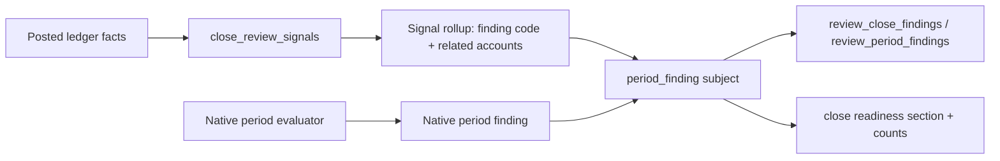

# Work Items and Transaction Lifecycle

Status: Draft for product/engineering alignment
Owner: Product + Engineering

This document defines the lifecycle model, work item rules, and recommended system changes. For the plain-language product narrative, read [Transaction Work Story](./transaction-work-story.md). For the source-to-queue implementation map, read [Transaction Flow To Work Queue Build Map](./transaction-flow-to-work-queue-build-map.md).

## 1. Product Principle

The firm queue is not a log of everything that happened. It is a list of work that requires attention.

Informational events must go to activity, notifications, audit, or transaction history. They must not appear in the primary work queue unless a user, firm policy, close policy, or system rule requires someone to act.

Examples:

- Bank transaction synced: informational.
- Candidate created and needs approval: actionable.
- Auto-post succeeded under enabled policy and confidence threshold: informational.
- Auto-post failed because a required posting field is missing: actionable if a user can fix it.
- Close finding rollup found after posting and no matching decision exists: actionable.

### 1.1 Narrative Reference

The product story is intentionally maintained separately in [Transaction Work Story](./transaction-work-story.md). This lifecycle reference should stay consistent with that story.

## 2. Core Model

Use a two-level work model.

### 2.1 `work_items`

`work_items` are the grouped rows users see in the firm queue.

Each row must answer:

- What work is this?
- Which client and period does it affect?
- What is the primary action?
- Where should the user land?
- How many underlying subjects need attention?
- Is the work actionable now, blocked by client/dependency, or waiting on system?

### 2.2 `work_item_subjects`

`work_item_subjects` are the exact fixable units under a grouped row.

A subject can point to:

- `bank_transaction`
- `categorization_candidate`
- `ledger_transaction`
- `ledger_entry`
- `close_review_signal` as linked evidence, not usually as the queue's canonical subject
- `period_finding` for close finding rollups and native period-level findings
- `fiscal_period`
- `journal_batch`
- `bank_account`
- `client_query`

Future tax, invoice, payroll, and compliance modules are out of launch scope. When those modules exist, they can add their own subject types using the same model.

The queue row stays calm. The subjects keep the workflow precise.

## 3. Work Item Rules

### 3.1 One Row Must Have One Primary Action

A grouped work item must not mix different user intentions.

Good:

- `Categorize 8 transactions`
- `Review 12 categorization suggestions`
- `Resolve 3 posting blockers`
- `Add missing contacts to 5 receivable postings`

Bad:

- `Fix 28 categorization items`
- `Review activity`
- `Transactions need attention`

If the required action differs, create a different work item.

### 3.2 Grouping Key

Group work by:

- `client_company_id`
- `period_id` or explicit date range
- `work_type`
- `action_mode`
- optional policy/source family when it changes the user action

Do not group by individual transaction date in the firm queue. Transaction date belongs on the subjects. The target workspace can group/sort/filter by date.

### 3.3 Work Materializer Contract

The work materializer is the load-bearing component.

It must be idempotent:

```ts
materializeWork(scope);
```

Where `scope` is one of:

- `company_period`: client company plus fiscal period
- `company`: client company, not tied to one period
- `bank_account`: one connected/imported bank account
- `firm`: firm-level work across clients

The common close path can call `materializeWork({ scopeType: 'company_period', clientCompanyId, periodId })`. The broader shape matters because some valid work, such as bank reconnection and client queries, is not period-scoped.

The materializer should compute desired open work from current domain facts, reconcile existing rows, and be safe to run repeatedly.

Inputs:

- bank transaction state
- categorization candidates and outcomes
- ledger postings
- journal drafts/postings
- close review signals
- close finding projection, including signal rollups and native period findings
- fiscal period/workflow status
- client/bank/client-query conditions

Outputs:

- grouped `work_items`
- exact `work_item_subjects`
- action availability from the action registry

Triggers:

- bank transaction import/sync
- categorization candidate created/replaced/rejected/posted/expired
- manual posting
- auto-post success/failure
- journal draft/post/reverse/void
- ledger write
- close signal sync
- close decision
- close finding projection recompute
- fiscal period/workflow status change
- bank connection status change
- client query opened/responded/closed
- sweep backstop

The materializer must not be the source of accounting truth. It is a reconciliation layer.

Rules:

- For categorization/action subjects, open/resolved state is derived from source facts. Example: a `needs_categorization` subject is no longer open once the bank transaction has a posted ledger transaction.
- For close/advisory subjects, open/resolved state is derived from the close finding projection plus matching decisions. Example: a signal rollup with a matching `close_review_decisions` row for the same facts hash should not materialize as open work.
- The UI must not directly mark `work_item_subjects` as resolved. User actions mutate the domain source or create a decision; the materializer then reconciles the work surface.
- Missing desired subjects should be ended or removed by reconciliation, not hand-maintained as independent truth.
- Close readiness and the materializer must consume the same close finding projection. Readiness may group, count, and label it differently, but it must not recompute a second version of the same period finding.

Concurrency rules:

- Every materialization request must carry a stable `scope_key`.
- Pending `work_materialization_requested` intents should be debounced by `(intent_type, scope_key)` so one 100-transaction sync does not create 100 competing recomputes.
- Before computing desired work, `materializeWork(scope)` must acquire a database advisory lock for the `scope_key`.
- The desired set must be computed after the lock is acquired, from current domain facts.
- Upserting desired subjects, ending no-longer-desired subjects, recomputing grouped counts, and closing empty grouped items must happen in one locked transaction.
- A grouped work item may be closed only by a conditional update that confirms no active subjects remain.
- Inline fast materialization and the outbox worker must use the same lock. If inline materialization cannot acquire the lock quickly, return success with a refresh hint and let the outbox worker finish reconciliation.

### 3.4 Subject Ownership

A canonical subject key may belong to at most one open work item at a time.

Canonical subject identity is not the raw table row. It is the pair of:

- required action intent
- target being acted on

Shape:

```ts
canonical_subject_key = `${intent}:${target_type}:${target_id}`;
```

The target is usually a table row or rollup fingerprint. The intent is what prevents ambiguity when the same physical row supports genuinely different work.

Examples:

- A bank transaction needing categorization: `categorize:bank_transaction:{id}`
- A candidate needing review: `review_suggestion:categorization_candidate:{id}`
- A posted ledger entry needing human categorization review: `review_posted_categorization:ledger_entry:{id}`
- A close finding rollup from one or more close review signals: `review_close_finding:period_finding:{rollupFingerprint}` with child signals and ledger rows as linked evidence
- A native period-level finding: `review_period_finding:period_finding:{rollupFingerprint}`
- A ready-to-close receipt: `close_ready_receipt:fiscal_period:{periodId}`

If several producers find issues on the same canonical subject, the materializer should attach multiple reasons/findings to one subject instead of creating duplicate work.

This prevents one ledger entry with both a policy review and a close signal from appearing as two different queue rows asking the user to do the same thing.

The same physical row can back more than one canonical subject only when the required action intent differs. Example: `review_posted_categorization:ledger_entry:{id}` and `review_close_finding:period_finding:{rollupFingerprint}` may coexist if one action is "mark this auto-post reviewed" and the other is "post or decision a missing depreciation finding." They should not coexist if both ask the user to make the same fix.

Close work should be canonicalized at the rollup finding grain by default:

- Identity: company, period, finding code, and the stable rollup dimensions such as related accounts.
- Current state: `facts_hash`, computed from the material facts behind that rollup.
- Evidence: child `close_review_signals`, ledger entries, ledger transactions, journal batches, bank transactions, and account ids.

Do not create one queue subject per `close_review_signals` row unless the product intentionally wants row-by-row review for that specific finding. The calm queue row is the rollup; the raw signals are how the workspace drills down.

### 3.5 Queue Eligibility

A fact creates a queue item only when it is:

- `actionable_now`
- `blocked_by_client`
- `blocked_by_dependency`
- `waiting_on_system` only if it is stuck, failed, or overdue

Facts with state `informational` must not create work items.

Target actionability enum:

- `actionable_now`
- `blocked_by_client`
- `blocked_by_dependency`
- `waiting_on_system`

Informational events belong to activity, not work item actionability. The current frontend contract's `informational` actionability state should be replaced or removed before launch.

`waiting_on_system` is not a label for normal in-progress automation. Use it only when all of these are true:

- there is a real user-visible workflow waiting on a system or external condition
- the user cannot fix it directly from the normal workspace
- the condition is past an SLA, exhausted its retry budget, or has been explicitly marked as stuck

Examples: a bank provider outage, a sync stuck past threshold, a report send job that failed after retry, or an auto-post job paused by an operational hold. These belong in a waiting section, not in the main actionable-now list.

If the next step is client action, use `blocked_by_client`, not `waiting_on_system`. A bank reconnect task that requires the client to re-authenticate is `blocked_by_client`. A bank sync delayed because the provider/API is down is `waiting_on_system`.

### 3.6 Action Contract

Every work item type must define an action contract in code.

Required fields:

- `primary_action`
- `secondary_actions`
- `bulk_actions`
- `required_capabilities`
- `destination`
- `subject_selector`
- `subject_resolution_predicate`
- `work_item_resolution_predicate`

The frontend should not infer what a work item can do from the title. The API should return enough structure for the UI to show the correct button, route, filters, disabled states, and permission-denied reasons.

Permissions belong in the action contract as capabilities, not hard-coded frontend role logic. The backend must still enforce authorization when the action is executed.

Use capability-style requirements instead of role names where possible:

- `categorization.post`
- `categorization.reject_suggestion`
- `ledger.amend`
- `journal.post`
- `close.acknowledge_finding`
- `close.reopen_period`

The API can return both:

- all actions that exist for this work type
- the subset available to the current user, with disabled reasons

Example:

```ts
{
  workType: 'review_categorization_suggestions',
  primaryAction: 'review_suggestions',
  secondaryActions: ['assign', 'defer'],
  bulkActions: ['post_all_eligible', 'reject_selected'],
  requiredCapabilities: {
    post_all_eligible: ['categorization.post'],
    reject_selected: ['categorization.reject_suggestion'],
  },
  destination: {
    workspace: 'categorization',
    filterMode: 'work_item_subjects',
  },
}
```

### 3.7 Audience And Assignment

The action contract answers "what can this viewer do?" It does not fully answer "whose queue should this appear in?"

Work items need an audience and assignment contract too.

Launch stored fields:

- `firm_company_id`
- `client_company_id`
- `assigned_to_user_id`
- `required_capabilities` for each action
- `available_actions` for the current viewer
- destination data needed to open the correct workspace

Derived API fields:

- `client_owner_user_id` or `client_assignee_user_id`, read from the client assignment model
- `effective_owner_user_id`

Defer until the matching product feature exists:

- `team_id`
- broad stored `visibility_scope`
- `watcher_user_ids`

Default queue views:

| Viewer           | Default view              | Can switch/filter to                                | Typical purpose                  |
| ---------------- | ------------------------- | --------------------------------------------------- | -------------------------------- |
| Staff/bookkeeper | My assigned work          | Client pool they can access, if policy allows       | Do the work.                     |
| Manager          | Team and assigned clients | Assignee, client, blocked/waiting, overdue          | Balance workload and review.     |
| Admin/firm owner | Firm-wide queue           | Any assignee, client, status, team, unassigned work | Operate the firm and spot risk.  |
| Solo firm user   | All own firm work         | Client/status filters                               | Same person is worker and owner. |

The existing firm dashboard mock already points this way: staff default to "My tasks"; managers/admins see team features, assignee filters, and firm/team transaction stats.

Effective owner rule:

```ts
effective_owner_user_id =
  assigned_to_user_id ?? client_assignee_user_id ?? null;
```

If a work item is not explicitly assigned but the client has a bookkeeper/client assignee, it should appear in that bookkeeper's default work view. If neither exists, it belongs to the unassigned pool for managers/admins.

Example: `Categorize 5 uncategorized transactions`

| Viewer                                                | What they see by default                                                                                                            | Best UX                                                                                                                                               |
| ----------------------------------------------------- | ----------------------------------------------------------------------------------------------------------------------------------- | ----------------------------------------------------------------------------------------------------------------------------------------------------- |
| Assigned bookkeeper                                   | One ready-to-work row in My tasks: `Categorize 5 transactions`, with client, period, due/priority, and primary action `Categorize`. | Take them straight to the categorization workspace filtered to those 5 subjects. The row disappears or count drops as subjects are posted.            |
| Client-assigned bookkeeper, no explicit task assignee | Same as assigned bookkeeper via effective owner fallback.                                                                           | Do not require a manager to assign obvious client work manually.                                                                                      |
| Unrelated bookkeeper                                  | Nothing by default.                                                                                                                 | They should not inherit noise from other clients unless firm policy exposes a pool view.                                                              |
| Manager                                               | Same work item in team/client view, labelled with assignee or `Unassigned`.                                                         | Show workload/risk: assignee, client, age, due, blocked state, and actions such as assign, reassign, nudge, or open. Do not duplicate the worker row. |
| Firm owner/admin                                      | Same work item in firm-wide queue/portfolio rollups.                                                                                | Default to oversight: unassigned/overdue/high-risk/client-health views first, with drill-down to the exact row. They can still open or reassign.      |
| Solo firm user                                        | Same row in their all-work view.                                                                                                    | Treat them as both worker and owner; no team chrome unless useful.                                                                                    |

Backend rules:

- Authorization still happens on action execution.
- Queue visibility should be computed server-side, not trusted to frontend filters.
- Managers/admins can see work they cannot personally execute; those actions should return disabled reasons or management actions such as assign, reassign, nudge, or open read-only.
- Unassigned work belongs in the relevant client/team/firm pool so managers/admins can triage it.
- A work item can be visible to a manager/admin while assigned to a staff member; visibility is not ownership.

### 3.8 Work Type Vocabulary

Use one vocabulary across backend registry, contracts, frontend, and docs.

This document supersedes the current `task-registry` naming where the two differ.

| Current name                | Target name                         | Note                                                                                 |
| --------------------------- | ----------------------------------- | ------------------------------------------------------------------------------------ |
| `categorize_transactions`   | `categorize_transactions`           | Keep.                                                                                |
| `review_ai_categorizations` | `review_categorization_suggestions` | Suggestions may come from rules, ML, or future engines, not only AI.                 |
| none                        | `resolve_categorization_blockers`   | New. User-fixable condition prevents posting.                                        |
| none                        | `review_posted_categorizations`     | New. Only explicit policy creates this work.                                         |
| `review_draft_journals`     | `review_draft_journals`             | Keep for draft/invalid journal work.                                                 |
| none                        | `review_close_findings`             | New. Rollup close/advisory findings from posted ledger facts.                        |
| none                        | `review_period_findings`            | New. Period-level close findings such as trial balance, FX, and depreciation review. |
| `prepare_period_for_review` | `prepare_period_for_review`         | Keep for preparer workflow.                                                          |
| `request_review`            | `request_period_review`             | Rename for clarity.                                                                  |
| `approve_period`            | `approve_period`                    | Keep.                                                                                |
| none                        | `ready_to_close_period`             | New positive completion/receipt work item.                                           |
| `send_reports`              | `send_reports`                      | Keep.                                                                                |
| `close_period`              | `close_period`                      | Keep.                                                                                |
| `reconnect_bank`            | `reconnect_bank`                    | Keep.                                                                                |
| `respond_to_queries`        | `respond_to_queries`                | Keep until client-query system is renamed.                                           |

## 4. Bank-Sourced Transaction Processing States

The system must distinguish these states for bank-sourced transactions.

The first two states are system processing phases, not queue work and not necessarily persisted as a dedicated transaction-state enum. They are useful for automation timing, audit/history, and suppressing premature queue noise while rules/ML are actively running.

| State                           | Meaning                                                                         | Queue?        | User action                                             |
| ------------------------------- | ------------------------------------------------------------------------------- | ------------- | ------------------------------------------------------- |
| `bank_transaction_recorded`     | Bank transaction exists. Processing may not have run yet.                       | No            | None                                                    |
| `categorization_in_progress`    | Rules/ML/enrichment is running or within the automation-settling window.        | No            | None                                                    |
| `needs_categorization`          | No active candidate and no posted ledger transaction.                           | Yes           | Choose account(s) and post                              |
| `suggestion_ready_for_review`   | A valid candidate exists, but system should not auto-post without user review.  | Yes           | Approve, edit and post, or reject                       |
| `scheduled_for_autopost`        | A valid candidate met auto-post policy and is waiting for the configured delay. | No by default | Optional manual intervention from transaction table     |
| `posting_requires_user_action`  | Posting cannot proceed until a user fixes a business/accounting condition.      | Yes           | Fix condition, reject candidate, or choose another path |
| `posted_from_bank_transaction`  | Ledger is the accounting truth for the bank transaction.                        | No by default | None                                                    |
| `review_required_after_posting` | Posted item requires review by firm/close policy.                               | Yes           | Review, amend, or decide where policy allows            |
| `closed_period_action_required` | Posted/changed item affects a closed period.                                    | Yes           | Reopen, adjust, or document decision                    |

Important: auto-post is a transition into `posted_from_bank_transaction`, not a queue state. It is informational by default. It becomes queue-worthy only if a separate policy says it must be reviewed, or if close/posting checks produce an actionable finding.

`posting_requires_user_action` must not be used for malformed provider data, transient job failures, or internal system faults. Those should go to system retry, operations alerts, or ingestion remediation. It is only for conditions a normal authorized user can reasonably resolve in-product.

`suggestion_ready_for_review` and `posting_requires_user_action` must not be treated as synonyms.

- `suggestion_ready_for_review`: the proposal is valid, but policy requires a human decision before posting.
- `posting_requires_user_action`: the proposal cannot become a valid posting until a user fixes a business/accounting condition.

If the user can safely post the proposal as-is after approving it, the state is `suggestion_ready_for_review`.

If the user must change something before posting can succeed, the state is `posting_requires_user_action`.

### 4.1 Work State To Work Item Mapping

Categorization work items are materialized from work states. They are not a separate taxonomy.

| Work state                      | Work item type                                                                        | Queue reason                                                                      |
| ------------------------------- | ------------------------------------------------------------------------------------- | --------------------------------------------------------------------------------- |
| `needs_categorization`          | `categorize_transactions`                                                             | User must choose account(s) before the bank transaction can become ledger truth.  |
| `suggestion_ready_for_review`   | `review_categorization_suggestions`                                                   | System has a valid suggestion but policy requires a user decision before posting. |
| `posting_requires_user_action`  | `resolve_categorization_blockers`                                                     | A user-fixable business/accounting condition prevents posting.                    |
| `review_required_after_posting` | `review_posted_categorizations`, `review_close_findings`, or `review_period_findings` | Posted ledger facts require review by explicit firm or close policy.              |
| `closed_period_action_required` | close/period exception item                                                           | Work affects a closed period and requires a period-level decision.                |

Non-queue states such as `bank_transaction_recorded`, `categorization_in_progress`, `scheduled_for_autopost`, and `posted_from_bank_transaction` should not create work items by themselves.

Implementation note: if the product chooses not to expose "processing" in the transaction workspace, launch can derive these phases from bank transaction timestamps and job/candidate state instead of storing them as formal lifecycle states.

`review_required_after_posting` is a routing state, not one work type.

- Use `review_posted_categorizations` for explicit firm/source policy such as "a human must review ML auto-posts before close."
- Use `review_close_findings` or `review_period_findings` for close-readiness policy produced from posted facts.
- If both policies point to the same fix, create one canonical subject with multiple reason codes.
- If the actions are genuinely different, separate work is allowed. Example: "mark this auto-post reviewed" and "post a missing depreciation journal" are not the same action.

## 5. Categorization Work Items

### 5.1 `categorize_transactions`

Mapped work states:

- `needs_categorization`

Subject selector:

- bank transactions in the period
- no posted ledger transaction
- no active usable candidate

Primary action:

- categorize and post

Subject actions:

- choose account
- split
- add contact/project/reference/description
- post

Resolution:

- a posted ledger transaction exists, or the bank transaction is deleted/voided.

### 5.2 `review_categorization_suggestions`

Mapped work states:

- `suggestion_ready_for_review`

Subject selector:

- active candidates in the period
- no posted ledger transaction
- candidate is valid
- candidate needs a user decision because auto-post is disabled, confidence is below auto-post threshold, approval is required, or user/firm policy requires manual approval.

Primary action:

- review suggestions

Subject actions:

- post as suggested
- edit and post
- reject suggestion
- bulk post eligible suggestions

Resolution:

- candidate is posted, rejected, superseded, expired, or the source transaction is posted by another path.

### 5.3 `resolve_categorization_blockers`

Mapped work states:

- `posting_requires_user_action`

Subject selector:

- candidate or bank transaction cannot be posted
- the next step requires user correction

Primary action:

- fix blocker

Subject actions:

- choose replacement account
- add required missing data
- reject candidate
- retry posting

Resolution:

- blocker condition disappears, subject is posted, or subject is no longer actionable.

### 5.4 `review_posted_categorizations`

This work item must not be created just because transactions were auto-posted.

Mapped work states:

- `review_required_after_posting`

Subject selector:

- posted ledger entries that require review because of explicit policy

Valid policies:

- firm requires review of ML auto-posts
- firm requires review of rule auto-posts for selected rules or clients
- source/account/fiscal period policy requires categorization quality review
- pre-post advisory decision requires human confirmation after posting

Primary action:

- review posted categorization

Resolution:

- ledger entry is marked human-reviewed, amended/reposted where required, or accepted according to the policy.

Do not use this work type for normal close findings. If the reason is "these posted facts violate or trigger close policy," route to `review_close_findings` or `review_period_findings`.

### 5.5 Close Finding Work

Close finding work is produced from the close finding projection.

The close finding projection is the only place that computes:

- signal rollups from `close_review_signals`
- native period findings such as trial balance, FX revaluation, and depreciation review
- fingerprint, facts hash, severity, decision eligibility, and linked evidence

The materializer consumes this projection. Close readiness consumes this projection. Neither should independently recompute queue-worthy findings.

Work types:

- `review_close_findings`: rollups whose evidence comes from one or more `close_review_signals`
- `review_period_findings`: findings computed at period grain, such as trial balance, FX revaluation, or depreciation review

Canonical subject:

- `period_finding:{rollupFingerprint}`

The subject stores the current `facts_hash`. If the facts change, an old decision no longer suppresses the finding.

Decision table:

| Severity             | Queue?                         | Work type                                                        | Allowed completion                                           | Notes                                                                                                             |
| -------------------- | ------------------------------ | ---------------------------------------------------------------- | ------------------------------------------------------------ | ----------------------------------------------------------------------------------------------------------------- |
| `blocker`            | Yes                            | Usually `review_period_findings` or source-specific blocker work | Fix source facts only                                        | No acknowledgement, not-applicable, or dismissal should satisfy a blocker unless policy explicitly downgrades it. |
| `required_review`    | Yes                            | `review_close_findings` or `review_period_findings`              | Fix, acknowledge, or mark not applicable                     | The user is making an accounting/review decision for current facts.                                               |
| `advisory`           | Not by default                 | None by default; optional configured review work                 | Dismiss, acknowledge, or mark not applicable if surfaced     | Advisory findings should usually appear inline, in readiness, or in activity, not the main queue.                 |
| `final_confirmation` | Yes only inside the close step | `ready_to_close_period`                                          | Confirm, request review, or close/send according to workflow | This is content of the receipt/action, not a precondition for creating the receipt.                               |

Decision meanings:

- `acknowledged`: the finding applies, and the user accepts the current facts for this period.
- `not_applicable`: the finding does not apply to this company/period/fact pattern, with a reason.
- `dismissed`: the user is hiding or declining an optional advisory surface; it is not an accounting conclusion.

Target rule: `dismissed` must not satisfy blockers or required close-review findings. If `dismissed` remains in `close_review_decisions`, code should enforce that it only suppresses optional/advisory surfacing. Otherwise, remove it from the close decision model before launch.

## 6. Bulk Actions

Bulk actions belong to the grouped work item, but eligibility belongs to each subject.

Example:

`Review 12 categorization suggestions`

Allowed bulk actions:

- post all eligible
- reject selected
- assign selected

A subject is bulk eligible only if:

- candidate is still active
- source bank transaction is still unposted
- period is open
- posting validation passes
- required pre-posting advisories are either resolved or decisioned

Mixed groups are allowed only when the primary action is the same. The UI must show separate counts for eligible, blocked, and already resolved subjects.

## 7. Suggestion Outcome Model

Do not use one overloaded enum for accuracy, lifecycle, and edit distance.

Use three layers:

1. terminal lifecycle disposition
2. final posting comparison, when a fair comparison is possible
3. close/advisory review, when the posted ledger facts deserve review

These layers answer different questions.

- Disposition asks: what happened to this suggestion?
- Final posting comparison asks: how close was this suggestion to the ledger posting that actually happened?
- Close/advisory review asks: even if the posting matches user preference, does it satisfy our review policy?

Do not use suggestion outcome to judge accounting correctness. A company may consistently prefer an account that is not best practice. That is still useful learning for prediction. Close policy is where we challenge, warn, or ask for acknowledgement.

### 7.1 Terminal Disposition

Each candidate can have exactly one terminal disposition.

| Disposition  | Meaning                                                                         | Accuracy metric?           |
| ------------ | ------------------------------------------------------------------------------- | -------------------------- |
| `posted`     | This candidate was the basis of a ledger posting.                               | Yes, compare posting shape |
| `rejected`   | A user explicitly rejected this candidate before it was posted.                 | Yes, negative feedback     |
| `superseded` | The system replaced this candidate with a newer/better candidate before action. | No by default              |
| `expired`    | The candidate became non-actionable before evaluation.                          | No                         |

`expired` does not mean the candidate was right or wrong. It means we cannot fairly evaluate it. Reasons include `source_already_posted`, `source_deleted`, `period_locked`, `candidate_invalidated`, or `account_inactive`.

### 7.2 Final Posting Comparison

Any candidate or prediction may receive a final posting comparison if:

- the source transaction eventually posts to the ledger
- the candidate/prediction existed before the posting decision, or close enough that comparison is fair
- the comparison is marked as observational when the candidate was not the basis of posting

The comparison must not change the terminal disposition.

Examples:

- User posts candidate as suggested: disposition `posted`, comparison `exact`.
- User rejects a candidate but later posts the same account manually: disposition `rejected`, comparison `exact`, derived acceptance label `rejected_but_matched_later`.
- User manually posts before a delayed ML suggestion lands: disposition `expired`, reason `source_already_posted`; comparison may be stored only if the prediction existed before the manual posting.
- Candidate was generated after the transaction had already been posted: disposition `expired`, reason `source_already_posted`, no fair comparison.

| Posting comparison   | Meaning                                                                                        |
| -------------------- | ---------------------------------------------------------------------------------------------- |
| `exact`              | The material posting and non-accounting fields match the candidate.                            |
| `metadata_changed`   | Accounting shape matches, but description/reference/contact/project/notes/attachments changed. |
| `accounting_changed` | Account, amount, split, posting date, tax code, bank leg, or debit/credit structure changed.   |
| `not_comparable`     | No fair comparison should be made.                                                             |

`acceptance` should be derived, not stored as another lifecycle enum.

- `accepted`: disposition `posted` and comparison `exact`.
- `accepted_with_metadata_edits`: disposition `posted` and comparison `metadata_changed`.
- `posted_with_accounting_changes`: disposition `posted` and comparison `accounting_changed`.
- `rejected_but_matched_later`: disposition `rejected` and observational comparison `exact`.

`comparison_mode` should be explicit:

| Comparison mode                  | Meaning                                                                                                     |
| -------------------------------- | ----------------------------------------------------------------------------------------------------------- |
| `basis_of_posting`               | The candidate was used to create the posted ledger transaction.                                             |
| `observational_after_other_path` | The source posted through another path, but the candidate existed early enough to compare fairly.           |
| `not_comparable`                 | The candidate did not exist early enough, source facts changed too much, or comparison would be misleading. |

### 7.3 Comparison Details

Store structured details for learning and audit:

- `account_exact`
- `account_type_match`
- `account_element_match`
- `candidate_account_was_fallback`
- `fallback_refined`
- `amount_match`
- `split_shape_match`
- `posting_date_match`
- `contact_match`
- `project_match`
- `description_match`
- `reference_match`

Examples:

- User changes only description: disposition `posted`, comparison `metadata_changed`, `description_match=false`, accounting fields still match.
- User changes account within the same account type: disposition `posted`, comparison `accounting_changed`, `account_type_match=true`, `account_exact=false`.
- Candidate used fallback account and user chooses a specific account in the same type: disposition `posted`, comparison `accounting_changed`, `candidate_account_was_fallback=true`, `fallback_refined=true`.
- Candidate arrives after user manually posted the transaction: disposition `expired`, reason `source_already_posted`. It can be compared only if the prediction actually existed before the manual posting; otherwise it is `not_comparable`.

## 8. Pre-Posting Advice

Pre-posting advice is not the same thing as a persisted close finding.

Pre-posting advice answers:

> If this proposed posting is saved, what review issues will likely exist?

Close signals answer:

> Given what was actually posted, what review issues currently exist?

### 8.1 Implementation Model

Create a pure posting advisory evaluator that can run against a proposed posting draft.

Inputs:

- company
- bank transaction or journal source
- proposed ledger date
- proposed ledger lines
- accounts, account types, label roles
- contact/project/document state
- fiscal period

Output:

- advisory code
- severity
- message
- recommended fix
- decision options
- cross-phase key
- facts hash

The evaluator should share rules with close signal evaluation where possible, but it must not write `close_review_signals`.

Do not use the final close-signal fingerprint as the draft identity. A close-signal fingerprint may include `ledger_transaction_id` or `ledger_entry_id`, which do not exist before posting.

Use a stable cross-phase key both sides can compute:

- source entity type and id
- candidate/proposed posting id when available
- advisory/signal code
- account or line identity that exists before posting
- posting date or period when relevant

After posting, close signal evaluation should include the same cross-phase key alongside the final signal fingerprint.

Represent the key as a structured object and hash/canonicalize it for storage.

Minimum shape:

```ts
{
  sourceEntityType: 'bank_transaction' | 'journal_batch',
  sourceEntityId: string,
  proposedPostingId?: string,
  code: string,
  lineKey?: string,
  coaId?: string,
  accountRole?: string,
  periodKey: string,
}
```

Future ledger sources can add source entity values when those modules exist.

The final close-signal `fingerprint` remains the post-commit identity. The `cross_phase_key` is only the bridge between draft advice and the posted close finding.

### 8.2 When Advice Runs

Run advice at three points.

1. Candidate creation
   - Evaluate the candidate's proposed posting.
   - Store advisory summary on the candidate or a lightweight advisory cache.
   - This lets the table/inspector show warnings immediately.

2. User editing
   - Re-run advice when material draft fields change.
   - Use a preview endpoint so account metadata and fiscal period logic stay server-owned.
   - The UI should show inline advice while the user is working.

3. Final posting
   - Include advisory decisions in the posting request.
   - Persist ledger transaction.
   - After commit, run close signal evaluation.
   - If the posted signal has the same cross-phase key and facts hash as an acknowledged or not-applicable pre-post advisory, create the matching close review decision automatically.

### 8.3 Advisory Decisions

Decision options must be explicit:

- `fix_now`: user changes the draft before posting.
- `acknowledge`: user understands and proceeds.
- `not_applicable`: user says the rule does not apply, with optional reason.

Do not use a generic `ignore` as the stored decision. It is too vague.

Do not use post-commit `dismissed` as a pre-posting decision. Before posting, the user either fixes, acknowledges, or says the advice is not applicable.

### 8.4 Advisory Severity

Advisories should not all behave the same way.

Suggested severity model:

- `info`: helpful context, never blocks posting, never creates queue work.
- `warning`: user can proceed, but should see the issue before posting.
- `decision_required`: user must fix, acknowledge, or mark not applicable before posting.
- `blocking`: posting is invalid until fixed.

Only post-commit facts from `close_review_signals` should create close review work items. Pre-posting advisories live in the posting experience.

## 9. Close Review Lifecycle

1. Ledger posting commits.
2. Close signal evaluation runs after commit.
3. `close_review_signals` stores current facts.
4. `close_review_decisions` stores append-only decisions.
5. Period-level close findings are computed or materialized for the period.
6. Work materializer creates or resolves work item subjects from open findings in the close finding projection.
7. If a signal rollup or period finding has a matching decision by identity key and facts hash, it does not create actionable queue work.
8. If facts change, the prior decision no longer suppresses the new facts.

### 9.1 Rollup Grain

Close queue work should be at the rollup finding grain.



For signal-backed findings, the rollup fingerprint is the stable identity. The rollup `facts_hash` is the material state. Child signals, ledger entries, journal batches, bank transactions, and account ids are evidence linked to the subject.

For native period findings, use the same `period_finding` subject model. Do not force trial balance, FX revaluation, depreciation, or period sequence findings into fake ledger rows.

The close finding projection owns this computation. Readiness and the materializer read it.

Target `close_review_decisions.finding_scope` semantics:

- `period_finding`: the default for decision-eligible close work, including signal rollups and native period findings.
- `ledger_transaction_signal`: reserved for a future product case where the user must decision a specific ledger transaction signal directly.

Current code already records rollup decisions as `period_finding`; the work item layer should follow that grain.

### 9.2 Readiness Versus Queue

Close readiness and the firm queue are different surfaces over the same work reality.

- The firm queue shows assignable actionable rows.
- Close readiness shows a period dashboard: blockers, required reviews, confirmations, and positive readiness.
- Readiness may list the same open findings and work subjects by section and severity, but it should not create a second lifecycle or second resolution path.
- Queue rows should deep-link to the workspace for action. Readiness sections should deep-link either to the same work item subjects or to a period workspace filtered to those subjects.

If a new readiness condition is needed, add it to the close finding projection first. Then both readiness and the materializer can consume it.

## 10. Lifecycle State Machines

The system should model product-meaningful states, not every internal implementation step.

A state is product-meaningful when it changes at least one of:

- what the user can do
- what appears in the queue
- what table owns the truth
- what audit/history must explain
- what close/readiness should believe
- whether the system can act without a user

### 10.1 Bank Transaction Lifecycle

This lifecycle is owned by bank transaction ingestion, categorization, and ledger posting.

| State                           | Meaning                                                                                          | Truth owner                                  | Queue?                                                                                     | Allowed next actions                                                              |
| ------------------------------- | ------------------------------------------------------------------------------------------------ | -------------------------------------------- | ------------------------------------------------------------------------------------------ | --------------------------------------------------------------------------------- |
| `bank_transaction_recorded`     | A bank transaction exists. It has not yet produced a posting or actionable categorization state. | `bank_transactions`                          | No                                                                                         | enrich, run rules, run ML                                                         |
| `categorization_in_progress`    | Enrichment/rules/ML are currently running or retrying.                                           | `categorization_tasks`, job queues           | No                                                                                         | wait, retry system job                                                            |
| `needs_categorization`          | No posted ledger transaction and no active usable candidate.                                     | `bank_transactions`                          | Yes, `categorize_transactions`                                                             | user categorizes and posts, system retries, delete/void source                    |
| `suggestion_ready_for_review`   | A valid active candidate exists, but system should not auto-post without user review.            | `categorization_candidates`                  | Yes, `review_categorization_suggestions`                                                   | post as suggested, edit and post, reject                                          |
| `scheduled_for_autopost`        | A valid candidate met auto-post policy and is waiting for the configured delay.                  | `categorization_candidates`, auto-post queue | No by default                                                                              | user can post manually, system auto-posts later, cancel if source changes         |
| `posting_requires_user_action`  | Candidate or user draft cannot post until a user fixes a business/accounting condition.          | validation result, candidate/source facts    | Yes, `resolve_categorization_blockers`                                                     | fix condition, reject candidate, retry posting                                    |
| `posted_from_bank_transaction`  | Bank transaction has a posted ledger transaction.                                                | `ledger_transactions`, `ledger_entries`      | No by default                                                                              | review if policy requires, edit allowed fields, amend if accounting fields change |
| `review_required_after_posting` | The posted bank-sourced ledger entry requires human/close review by explicit policy.             | ledger plus policy/close facts               | Yes, `review_posted_categorizations`, `review_close_findings`, or `review_period_findings` | review, amend, decide where severity/policy allows                                |
| `closed_period_action_required` | A posted transaction affects a closed period or would require changing one.                      | ledger, fiscal calendar                      | Yes                                                                                        | reopen, reverse/adjust in open period, document decision                          |
| `source_transaction_inactive`   | Source bank transaction is deleted, voided, or otherwise no longer active.                       | `bank_transactions`                          | No                                                                                         | audit only                                                                        |

Rules:

- `autoposted` is not a queue state. It is a transition into `posted_from_bank_transaction`.
- A bank transaction should not have an active candidate if it is already in `posted_from_bank_transaction`.
- Late candidates after posting move to candidate disposition `expired`, reason `source_already_posted`.
- Malformed provider data, transient job failures, and internal faults should not become `posting_requires_user_action`. They belong to system retry, operations alerts, or ingestion remediation.

### 10.2 Categorization Suggestion Lifecycle

This lifecycle is owned by predictions/candidates and should not be confused with the bank transaction lifecycle.

| State                 | Meaning                                                                     | Truth owner                          | Queue?                            | Terminal? |
| --------------------- | --------------------------------------------------------------------------- | ------------------------------------ | --------------------------------- | --------- |
| `prediction_recorded` | Rules/ML produced a raw prediction. It may not be usable.                   | `categorization_predictions`         | No                                | No        |
| `candidate_active`    | Prediction passed validation and became a user/system-actionable candidate. | `categorization_candidates`          | Depends on bank transaction state | No        |
| `candidate_replaced`  | A newer/better candidate superseded it before user action.                  | `categorization_suggestion_outcomes` | No                                | Yes       |
| `candidate_posted`    | Candidate became the basis of a ledger posting.                             | ledger plus outcome table            | No by itself                      | Yes       |
| `candidate_rejected`  | User explicitly rejected the candidate before posting.                      | outcome table                        | No                                | Yes       |
| `candidate_expired`   | Candidate became non-actionable before fair evaluation.                     | outcome table                        | No                                | Yes       |

Terminal disposition mapping:

- `candidate_posted` -> disposition `posted`
- `candidate_rejected` -> disposition `rejected`
- `candidate_replaced` -> disposition `superseded`
- `candidate_expired` -> disposition `expired`

Disposition `posted` means the candidate was the basis of posting. Other dispositions may still receive an observational final posting comparison when the comparison is fair. The comparison must not change the disposition.

### 10.3 Manual Journal Lifecycle

Manual journals do not pass through categorization candidates, but they should converge with bank transactions at the proposed posting stage.

Journals are first-class sources of ledger truth. Accruals, depreciation, revenue adjustments, corrections, and future plugin-generated entries may all arrive through journals. Their pre-posting advice can be source-specific, but once posted they should feed the same ledger, close signal, work item, and activity systems as bank-sourced postings.

| State                           | Meaning                                                                 | Truth owner                             | Queue?                                                                       | Allowed next actions                                     |
| ------------------------------- | ----------------------------------------------------------------------- | --------------------------------------- | ---------------------------------------------------------------------------- | -------------------------------------------------------- |
| `draft_empty`                   | Journal shell exists but is not postable.                               | `journal_batches`, `journal_entries`    | No by default                                                                | edit, delete                                             |
| `draft_invalid`                 | Draft has validation errors.                                            | journal draft tables                    | Yes only if part of active close/review work                                 | fix, delete                                              |
| `draft_valid`                   | Draft is balanced and can be posted.                                    | journal draft tables                    | No by default                                                                | post, edit, delete                                       |
| `draft_advisory_pending`        | Valid draft has warnings or decision-required advisories.               | advisory evaluator/cache                | No by default; shown inline                                                  | fix, acknowledge, mark not applicable, post if allowed   |
| `posting_requires_user_action`  | Journal cannot post until a user fixes a business/accounting condition. | validation result                       | Yes if user-actionable                                                       | fix, request permission, defer                           |
| `posted_journal`                | Journal has posted ledger entries.                                      | `ledger_transactions`, `ledger_entries` | No by default                                                                | reverse, amend where allowed, review if policy requires  |
| `review_required_after_posting` | Posted journal requires close/firm review.                              | ledger plus policy/close facts          | Yes, through close/period review work or future posted-journal review policy | review, amend, decide where severity/policy allows       |
| `reversed`                      | Posted journal has been reversed by an explicit reversing entry.        | ledger                                  | No by default                                                                | audit, possible follow-up adjustment                     |
| `voided`                        | Draft or posting was voided according to allowed rules.                 | journal/ledger audit                    | No                                                                           | audit only                                               |
| `closed_period_action_required` | Journal affects a closed period.                                        | ledger, fiscal calendar                 | Yes                                                                          | reopen, reverse/adjust in open period, document decision |

Rules:

- Draft journals are not categorization work.
- Draft journals can block close readiness.
- Once posted, bank-sourced and journal-sourced transactions should feed the same close signal and work materialization system.

### 10.4 Proposed Posting Lifecycle

This is the convergence point for bank transactions, candidates, and manual journals. Future ledger-producing modules can enter here when those modules exist.

| State                             | Meaning                                                                            | Queue?                                     | Owner                        |
| --------------------------------- | ---------------------------------------------------------------------------------- | ------------------------------------------ | ---------------------------- |
| `drafting`                        | User or system is constructing a posting.                                          | No                                         | source workflow              |
| `validating`                      | Server validates accounts, balance, period, permissions, source state, and policy. | No                                         | posting service              |
| `advice_available`                | Proposed posting is valid enough to evaluate advisories.                           | No, inline only                            | advisory evaluator           |
| `decision_required`               | Advisory or policy requires user decision before posting.                          | Not firm queue; inline in workspace        | advisory evaluator           |
| `ready_to_post`                   | Posting can be committed.                                                          | No                                         | posting service              |
| `posting_requires_user_action`    | Posting cannot proceed until a user fixes a business/accounting condition.         | Yes, if no longer in active inline context | work materializer            |
| `posting_failed_system_retryable` | Posting failed due transient/system issue.                                         | No unless stuck/overdue                    | job system                   |
| `posting_failed_system_attention` | Posting failed because of internal/system-owned data or code problems.             | No primary queue; operations alert         | operations/system monitoring |
| `posted`                          | Ledger transaction committed.                                                      | No by itself                               | ledger                       |

Rules:

- Pre-posting advice belongs here.
- Pre-posting advice should be shown inline, not as a firm queue item.
- Firm queue work appears only if the user leaves behind unresolved user-actionable work.

### 10.5 Posted Ledger Lifecycle

Ledger entries are the accounting truth once posted.

| State                    | Meaning                                                                               | Truth owner              | Queue?                                  | Allowed next actions       |
| ------------------------ | ------------------------------------------------------------------------------------- | ------------------------ | --------------------------------------- | -------------------------- |
| `posted_unreviewed`      | Posted ledger entry exists and has not been human-reviewed where review matters.      | `ledger_entries`         | Only if explicit policy requires review | review, amend, acknowledge |
| `posted_reviewed`        | Human review has been recorded.                                                       | `ledger_entries`         | No                                      | amend if allowed           |
| `posted_decisioned`      | A close/advisory finding was acknowledged or marked not applicable for current facts. | `close_review_decisions` | No for matching facts                   | reopen if facts change     |
| `amended`                | Accounting shape changed through a new version/supersession model.                    | ledger/audit             | Maybe, depending on period and policy   | review new facts           |
| `reversed`               | Reversal entry exists.                                                                | ledger                   | Maybe, if close policy flags it         | review if needed           |
| `closed_period_impacted` | Ledger activity affects a closed period.                                              | ledger, fiscal calendar  | Yes                                     | reopen, adjust, document   |

Rules:

- `human_reviewed` means a human reviewed the posted ledger entry. It does not mean a candidate was accepted.
- `human_reviewed` satisfies posted-categorization review policy only when that policy says human review is the required action.
- `human_reviewed` must not clear close findings by itself. A close finding is resolved by changed facts or by a valid close decision for the current facts and severity.
- Suggestion outcomes explain how the candidate compared to the final posting.
- Close decisions explain why an open finding no longer needs queue work.

### 10.6 Close Signal Lifecycle

Close signals are current review facts derived from posted ledger state.

| State                            | Meaning                                                          | Truth owner                                    | Queue?                                         | Allowed next actions                                               |
| -------------------------------- | ---------------------------------------------------------------- | ---------------------------------------------- | ---------------------------------------------- | ------------------------------------------------------------------ |
| `signal_detected`                | Evaluator found a current issue.                                 | `close_review_signals`                         | Through rollup finding if no matching decision | fix source, acknowledge, mark not applicable where severity allows |
| `signal_decisioned`              | User made a decision matching rollup fingerprint and facts hash. | `close_review_decisions`                       | No                                             | audit, reopen only if facts change                                 |
| `signal_resolved_by_fact_change` | The underlying posted facts changed and signal no longer exists. | absence from `close_review_signals` after sync | No                                             | audit                                                              |
| `signal_reopened`                | Same conceptual issue appears with changed facts hash.           | `close_review_signals`                         | Through rollup finding                         | new decision or fix                                                |

Rules:

- `close_review_signals` should stay current-state, not lifecycle-state.
- `close_review_decisions` is append-only lifecycle evidence.
- Work items are materialized from signal rollups, not stored inside signal rows.
- Raw `close_review_signal` rows are evidence. The queue subject is normally `period_finding:{rollupFingerprint}`.

### 10.7 Period Finding Lifecycle

Some close findings are period-level, not row-level.

Examples:

- `trial_balance_unbalanced`
- fixed asset/depreciation review
- FX revaluation review
- period sequence or prior-period conditions

These should not be forced into a fake ledger-entry subject. They are computed by the close finding projection and consumed by both readiness and the materializer.

| State                                    | Meaning                                                            | Truth owner                                       | Queue?                                       | Allowed next actions                                                                     |
| ---------------------------------------- | ------------------------------------------------------------------ | ------------------------------------------------- | -------------------------------------------- | ---------------------------------------------------------------------------------------- |
| `period_finding_detected`                | A period-level close finding is currently open.                    | close finding projection                          | Yes if queue-worthy and no matching decision | fix source facts, create journal, acknowledge, mark not applicable where severity allows |
| `period_finding_decisioned`              | User made a decision matching the finding identity and facts hash. | `close_review_decisions` or period decision table | No                                           | audit, reopen only if facts change                                                       |
| `period_finding_resolved_by_fact_change` | Close finding projection no longer produces the finding.           | absence from current projection after recompute   | No                                           | audit                                                                                    |
| `period_finding_reopened`                | Same conceptual finding appears with changed facts hash.           | close finding projection                          | Yes                                          | new decision or fix                                                                      |

Rules:

- Prefer a `period_finding` subject type for period-level work.
- If period findings are not persisted, the close finding projection must still emit a stable rollup fingerprint. The materializer uses that fingerprint as subject id and stores `facts_hash` as current material state.
- Subject-less work items should be avoided except for explicit positive workflow receipts such as `ready_to_close_period`.

### 10.8 Period Close And Approval Lifecycle

The work system should produce positive completion work, not only issues.

When a period has no open blockers and no open required reviews, materialize `ready_to_close_period`.

This is an affirming work item:

- It tells the preparer the period is ready.
- It summarizes what was done.
- It carries any final confirmations required before submission or close.
- It offers the next action, such as `close_and_send_for_approval`.
- It gives the user the psychological receipt that the books are clean enough to move forward.

Suggested flow:

| State                | Meaning                                                                                | Work item                            |
| -------------------- | -------------------------------------------------------------------------------------- | ------------------------------------ |
| `in_progress`        | Period still has open work or has not been prepared.                                   | normal issue/action work             |
| `ready_to_close`     | No open blockers or required reviews remain; final confirmations can now be completed. | `ready_to_close_period`              |
| `review_requested`   | Preparer submitted the period for approval.                                            | `approve_period` for reviewer        |
| `under_review`       | Reviewer is actively reviewing.                                                        | `approve_period`                     |
| `approved`           | Reviewer approved the period package.                                                  | `send_reports` or `close_period`     |
| `sent`               | Reports were sent to the client.                                                       | `close_period` if not already closed |
| `closed`             | Fiscal period is closed.                                                               | no open close workflow work          |
| `stale_after_change` | Ledger, close decision, or material facts changed after review was requested/approved. | reopen preparation/review work       |

Rules:

- "Close and send for approval" should create a review package snapshot and lock that package for review. It does not have to mean the fiscal period is finally closed.
- If material facts change after the package is sent, mark the workflow stale and require re-review.
- Final fiscal close should happen only after required approval/send steps are complete according to firm policy.

Material changes that should mark a review package stale:

- ledger transaction posted, amended, reversed, voided, or deleted in the period
- ledger entry review state changes when review state is part of close policy
- close review decision added for the period
- close signal rollup appears, disappears, or changes `facts_hash`
- period finding appears, disappears, or changes `facts_hash`
- trial balance, GL balance materialization, or account activity changes for the period
- bank transaction imported, removed, backdated, or newly posted into the period
- journal draft posted, reversed, voided, or dated into the period
- fiscal period reopened, locked, unlocked, or prior managed period changes state
- report-affecting configuration changes, such as accounting basis, close policy, materiality, chart-of-account role, or fiscal calendar changes

### 10.9 Non-Period And Adjacent Work Lifecycles

Some work is not naturally created by `company_period` materialization.

| Work type            | Scope                              | Opens when                                                                                 | Actionability                                                                                                       | Resolves when                                                                                  |
| -------------------- | ---------------------------------- | ------------------------------------------------------------------------------------------ | ------------------------------------------------------------------------------------------------------------------- | ---------------------------------------------------------------------------------------------- |
| `reconnect_bank`     | `bank_account`                     | Bank connection is disconnected, credential-expired, or stale beyond configured threshold. | `blocked_by_client` if client action is needed; `waiting_on_system` if provider/system retry is underway.           | Connection is healthy, account is intentionally archived, or firm marks it no longer required. |
| `respond_to_queries` | `company` or future `client_query` | A client/bookkeeper query is open and needs a response.                                    | `blocked_by_client` when waiting on client; `actionable_now` when assigned user can answer.                         | Query is answered, closed, or superseded.                                                      |
| `send_reports`       | `company_period`                   | Period package is approved and reports are generated/ready.                                | `actionable_now` for users with report-send capability; `waiting_on_system` while generation/send retry is running. | Reports are sent, skipped with policy reason, or package becomes stale.                        |
| `close_period`       | `company_period`                   | Required review/send steps are complete and policy allows final close.                     | `actionable_now` for users with close capability.                                                                   | Fiscal period becomes closed or package becomes stale.                                         |

These work types still use the same grouped `work_items`, exact `work_item_subjects`, action contract, and materializer reconciliation rules.

## 11. End-to-End Transaction Flow

1. Bank transaction is saved.
   - State: `bank_transaction_recorded`.
   - Queue: none.
   - Activity: transaction synced.

2. Categorization processing runs.
   - State: `categorization_in_progress`.
   - Queue: none while automation is running or retrying.
   - If automation ends with no usable proposal, the state becomes `needs_categorization`.
   - If automation discovers a user-fixable posting condition, the state becomes `posting_requires_user_action`.
   - System faults, malformed provider payloads, and transient job failures go to retry/operations/ingestion remediation, not the user queue.

3. System produces no candidate.
   - State: `needs_categorization`.
   - Work item: `categorize_transactions`.
   - Subject: bank transaction.

4. System produces candidate below auto-post policy.
   - State: `suggestion_ready_for_review`.
   - Work item: `review_categorization_suggestions`.
   - Subject: candidate.

5. System produces candidate eligible for auto-post.
   - If immediate: post it.
   - If delayed: state `scheduled_for_autopost`.
   - Queue: none by default.
   - Activity: auto-post scheduled or completed.

6. User opens a work item.
   - Route opens correct client workspace.
   - `work_item_id` or subject ids filter the workspace to exact rows.
   - Available actions come from work item type plus subject eligibility.

7. User posts, edits and posts, rejects, or bulk-posts.
   - Ledger becomes accounting truth if posted.
   - Candidate receives terminal disposition.
   - Posting comparison is recorded as `basis_of_posting` when disposition is `posted`.
   - Prior candidates may receive `observational_after_other_path` comparison only when the comparison is fair.

8. Ledger posting commits.
   - Schedule close signal evaluation.
   - Schedule work materialization for affected client and period.

9. Close signals sync.
   - Current findings are written to `close_review_signals`.
   - Surfaced signals roll up to `period_finding` subjects.
   - Prior matching decisions suppress queue work only for matching rollup fingerprint and facts hash.
   - New unresolved rollups create work item subjects.

10. Close readiness runs.

- It summarizes the same unresolved subjects and period conditions by section/severity.
- It should not replace the work item system or create a second resolution path.

11. If no blocking work remains, `ready_to_close_period` is materialized.

- User gets a positive completion receipt.
- Preparer can close/send for approval according to firm policy.

12. Review and approval happen.

- Review package is locked/snapshotted.
- Material changes after send mark the workflow stale and reopen preparation/review work.

13. Period closes.

- Normal open-period work should be resolved or decisioned.
- Later changes create closed-period exception work.

## 12. Recommended Table Changes

### 12.1 Rename Task Tables

Rename:

- `engagement_tasks` -> `work_items`
- `engagement_task_blockers` -> `work_item_blockers`

Do not treat `engagement_task_events` as the product activity stream. If queue-level audit proves necessary, rename or replace it with `work_item_events` later, scoped only to queue projection changes such as subject added, subject ended, item assigned, item closed, or item reopened.

Future signed client engagements can reference or generate work items, but daily queue work should not be named after engagements.

### 12.2 Add/Update `work_items`

Launch columns:

- `id`
- `firm_company_id`
- `client_company_id`
- `scope_type`
- `scope_key`
- `work_type`
- `title`
- `status`
- `priority`
- `actionability_state`
- `assigned_to_user_id`
- `subject_count`
- `active_subject_count`
- `blocked_subject_count`
- `waiting_subject_count`
- `primary_action`
- `destination`
- `first_seen_at`
- `last_seen_at`
- `closed_at`
- standard audit columns

Derived API fields:

- `client_assignee_user_id`
- `effective_owner_user_id`
- viewer-specific `available_actions`
- viewer-specific visibility and disabled reasons

Defer:

- `team_id`
- broad stored `visibility_scope`
- `watcher_user_ids`
- queue audit/event table

Assignment, grouping, and action summary live on the grouped work item. Exact fixable records live under `work_item_subjects`. Visibility is computed server-side from firm/client access, assignment, and capabilities until a richer team/watcher model exists.

### 12.3 Add `work_item_subjects`

Launch columns:

- `id`
- `work_item_id`
- `client_company_id`
- `canonical_subject_key`
- `canonical_subject_type`
- `canonical_subject_id`
- `producer`
- `linked_entities`
- `reason_codes`
- `subject_state`
- `actionability_state`
- `recommended_action`
- `facts_hash`
- `fingerprint`
- `display`
- `amount`
- `sort_date`
- `destination`
- `bulk_eligible`
- `first_seen_at`
- `last_seen_at`
- `is_active`
- `ended_at`
- `ended_reason`
- `materialized_at`
- standard audit columns

Defer `cross_phase_key` on `work_item_subjects` until cross-phase pre-post advisory conversion is implemented. Launch can keep advisory summaries on candidates or request payloads without making work subjects responsible for draft-to-posted identity.

Do not treat subject lifecycle fields as independent truth.

- For action subjects, active/open state is derived from source facts.
- For close/advisory subjects, active/open state is derived from current facts plus matching decisions.
- For period findings, active/open state is derived from the close finding projection plus matching decisions.
- Enforce one active subject per `canonical_subject_key`.
- For close findings, store the rollup fingerprint in `canonical_subject_id` or `fingerprint`, and store the current `facts_hash` separately.

### 12.4 Add Categorization Suggestion Outcomes

Add a table such as `categorization_suggestion_outcomes`.

Recommended columns:

- `id`
- `candidate_id`
- `prediction_id`
- `bank_transaction_id`
- `ledger_transaction_id`
- `disposition`
- `disposition_reason`
- `final_posting_comparison`
- `comparison_details`
- `comparison_mode`
- `actor_type`
- `actor_user_id`
- `occurred_at`
- standard audit columns

Enforce one terminal outcome per candidate.

Recommended values:

- `disposition`: `posted`, `rejected`, `superseded`, `expired`
- `final_posting_comparison`: `exact`, `metadata_changed`, `accounting_changed`, `not_comparable`
- `comparison_mode`: `basis_of_posting`, `observational_after_other_path`, `not_comparable`

Do not add a stored `acceptance` enum for launch. Expose acceptance labels as derived API fields if the UI needs them.

### 12.5 Add Pre-Posting Advisory Support

Recommended launch behavior:

- preview endpoint for draft advisory evaluation
- advisory summary on candidates or lightweight cache
- advisory decisions carried in posting request
- after posting, convert matching decisions into `close_review_decisions`

Do not add a durable `posting_advisory_decisions` table in the first work-item schema. Add it only when users need durable pre-post decisions before posting, or when cross-session draft advisory decisions become product behavior.

Later, if users need durable pre-post decisions before posting:

- `posting_advisory_decisions`

Suggested fields:

- `company_id`
- `source_entity_type`
- `source_entity_id`
- `proposed_posting_id`
- `advisory_code`
- `cross_phase_key`
- `facts_hash`
- `decision`
- `reason`
- `decided_by_user_id`
- `decided_at`

`cross_phase_key` should be generated from the structured shape in section 8.1 and stored as a canonical string/hash plus optional JSON debug fields.

### 12.6 Add Work Item Action Registry

Create a backend-owned action registry keyed by `work_type`.

The registry should define:

- action ids
- labels
- primary/secondary/bulk grouping
- required capabilities
- subject eligibility checks
- destination builder
- disabled reason builder

The firm queue API should return resolved action availability for the current user and current subject set.

This avoids coupling the frontend to firm role categories while still giving the UI enough structure to render correct actions.

### 12.7 Add Activity Event Contract

Informational events are product surface, not queue work.

`activity_events` is the user-facing product history stream. It is not the same thing as:

- notifications, which are delivery attempts and preferences for sending a message to someone
- operational logs, which are for engineering/debugging
- accounting audit records, which prove who changed accounting facts and when
- optional `work_item_events`, which would audit queue projection changes only

Define a lightweight activity event contract for events users may care about but do not need to act on immediately.

Examples:

- bank transactions synced/imported
- rule matched and posted a transaction
- ML suggestion created
- candidate auto-posted
- journal draft created
- journal posted
- recurring journal ran
- close finding resolved
- period report sent

Each activity event should carry:

- `firm_company_id`
- `company_id`
- `client_company_id` when different from `company_id`
- `actor_type`
- `actor_id`
- `subject_user_id` when the event should count toward a bookkeeper's wrap
- `event_type`
- `source_entity_type`
- `source_entity_id`
- `work_item_id` or `work_item_subject_id` when applicable
- `period_id` or event date
- `occurred_at`
- `summary`
- `details`
- `visibility`
- `correlation_id` or `causation_id`
- rollup dimensions such as `source`, `work_type`, `client`, `period`, and `actor`

Activity events can power transaction history, client activity feeds, audit views, and period wrap summaries such as "In April, 240 transactions were imported, 190 were posted automatically, 22 journals were posted, and 7 close findings were resolved."

For future wraps, store activity as append-only facts and build summaries from queries or materialized rollups:

- bookkeeper wrap: work completed, clients touched, transactions posted, reviews cleared, blockers resolved
- manager wrap: team throughput, aging work, overdue clients, reassigned/unassigned work
- firm owner/admin wrap: firm-wide volume, client health, automation impact, capacity, risk

Do not rely only on `work_item_events` for this. Some important activity never was a work item, such as auto-post success, imports, report sends, and journal posts.

Activity events must not become work items unless a policy or unresolved condition requires user action.

### 12.8 Add Notification Contract

Notifications are launch-critical attention management, not a replacement for the queue or activity.

The notification system should create in-app notifications and delivery records from product activity and materialized work transitions. It should not recompute accounting truth.

Recommended launch tables or equivalent records:

- `notifications`: recipient, firm/client context, event type, related activity/work/source ids, destination/action, priority, read/seen state, created timestamp
- `notification_deliveries`: notification id, channel, status, attempt count, provider id/error, sent/delivered/failed timestamps
- `notification_preferences`: user/channel defaults, digest/immediate preferences, quieting rules where needed

Launch notification rules:

- Notify when work is assigned or reassigned.
- Notify when assigned work becomes overdue or escalated.
- Notify when bank reconnect or client action is required.
- Notify for client query responses or requests.
- Notify for close package approval, rejection, and stale-after-change.
- Notify when report delivery needs user attention.
- Do not notify for every import, autopost, suggestion, or internal close recomputation. Record those in activity and summarize them in feeds/digests unless policy says action is required.

Notifications must use idempotency keys so retries, rematerialization, and sweeps do not repeatedly notify the same user for the same transition.

## 13. Current System Fit And Gaps

The current system already tells part of this story, but not all of it.

### 13.1 Already Aligned

- `bank_transactions`, `categorization_predictions`, `categorization_candidates`, `ledger_transactions`, and `ledger_entries` already separate source facts, suggestions, and ledger truth.
- `categorization_engine_view` already gives the UI a single mixed surface for unresolved transactions, candidates, and posted ledger entries.
- Rules/ML candidates can be persisted, replaced, and posted.
- Auto-post policy already exists for rules and ML settings, including delayed ML auto-post.
- Auto-post code already skips posting when the bank transaction has already been posted.
- User-driven categorization paths generally mark ledger entries as human-reviewed.
- Ledger writes already schedule close signal evaluation after commit.
- `close_review_signals` and `close_review_decisions` already model current close facts separately from append-only decisions.

### 13.2 Not Yet Aligned

- The task system is still named around `engagement_tasks`, not `work_items`.
- There is no first-class `work_item_subjects` table, so grouped work can say "47 items" without owning the exact fixable records underneath.
- Categorization does not yet have a clear work materializer that maps current states into work items and subjects.
- There is no single idempotent, scope-aware `materializeWork(scope)` reconciliation flow across categorization, journals, close findings, workflow state, bank connections, and client queries.
- There is not yet an enforced one-open-owner rule for canonical subjects.
- The task queue is not yet consistently refreshed after categorization candidate creation, manual posting, auto-posting, and close signal sync.
- Candidate persistence should explicitly avoid creating active candidates for already-posted bank transactions.
- We do not yet have `categorization_suggestion_outcomes` with terminal disposition plus final posting comparison.
- `categorization_task_events` has some lifecycle events, but it is not enough to answer the full suggestion outcome story.
- Pre-posting advisory evaluation does not yet exist as a reusable proposed-posting evaluator.
- Pre-post advisory decisions need a cross-phase key; they cannot rely on final close-signal fingerprints that require ledger ids.
- Close signal rollups do not yet materialize into `period_finding` work item subjects.
- Period-level close findings need the same `period_finding` subject model.
- `dismissed` currently exists in `close_review_decisions`; target semantics should prevent it from satisfying blockers or required reviews, or remove it from close decisions before launch.
- The positive `ready_to_close_period` receipt and stale-on-change review flow are not yet modeled in the queue.
- The firm queue API does not yet return a backend-owned action contract with current-user action availability.
- The current actionability contract still includes `informational`; target work item actionability should use `waiting_on_system` instead, with informational events moved to activity.

### 13.3 Rule For Future Implementation

When code and this document disagree, do not patch around the disagreement in the UI.

Either:

- fix the implementation so the product story is true, or
- update this document because the product story has intentionally changed.

The goal is not to preserve this document as scripture. The goal is to make sure every table, job, queue row, and user action can be explained by the same simple story.

## 14. Open Product Decisions

Decide items 1, 5, and 6 before building the first work materializer slice. They directly affect queue noise, grouping, and automation timing.

1. Should delayed auto-post candidates appear anywhere in the queue, or only in the transaction workspace/activity feed?
2. Should ML auto-posts ever require review by default, or only when firm/close policy asks for it?
3. Which advisory codes require an explicit decision before posting, if any?
4. Should metadata-only candidate edits count as success for ML quality dashboards?
5. What is the default date range for grouped categorization work: current open period, this week, or all unposted transactions?
6. Should newly imported transactions appear immediately as `needs_categorization`, or should the queue wait for a short automation-settling window while rules/ML run?
7. Should pre-posting advisory results be visible in the first version, stored but hidden, or deferred entirely until close review?
8. When both rules and ML produce valid proposals, should rules always own the active candidate, or should confidence/policy sometimes allow ML to replace a rule-backed suggestion?
9. Should `dismissed` remain in `close_review_decisions` for optional advisories only, or should close decisions be limited to `acknowledged` and `not_applicable`?
