# Accountable Books - Codebase Overview

> AI-native accounting platform for accounting firms and businesses.
> Generated from direct code inspection on 2026-02-14. Branch: `feature/manual-journals`

---

## Table of Contents

- [1. Executive Summary](#1-executive-summary)
- [2. Critical Issues (Act Now)](#2-critical-issues-act-now)
- [3. System Architecture](#3-system-architecture)
  - [3.1 High-Level Architecture](#31-high-level-architecture)
  - [3.2 Monorepo Structure](#32-monorepo-structure)
  - [3.3 Technology Stack](#33-technology-stack)
  - [3.4 Data Flow: Transaction to Ledger](#34-data-flow-transaction-to-ledger)
- [4. Backend API](#4-backend-api)
  - [4.1 Domain-Driven Architecture](#41-domain-driven-architecture)
  - [4.2 Authentication and Authorization](#42-authentication-and-authorization)
  - [4.3 Database and ORM](#43-database-and-orm)
  - [4.4 Job Queue and Worker System](#44-job-queue-and-worker-system)
  - [4.5 Error Handling](#45-error-handling)
- [5. Categorization Engine](#5-categorization-engine)
  - [5.1 Pipeline Overview](#51-pipeline-overview)
  - [5.2 Enrichment](#52-enrichment)
  - [5.3 Rules Engine](#53-rules-engine)
  - [5.4 ML Prediction](#54-ml-prediction)
  - [5.5 Candidates and Autoposting](#55-candidates-and-autoposting)
  - [5.6 Intent System](#56-intent-system)
- [6. Frontend Application](#6-frontend-application)
  - [6.1 Architecture and Routing](#61-architecture-and-routing)
  - [6.2 State Management](#62-state-management)
  - [6.3 Key Features](#63-key-features)
  - [6.4 Authentication Flow](#64-authentication-flow)
- [7. ML Engine Service](#7-ml-engine-service)
- [8. Shared Packages](#8-shared-packages)
- [9. Infrastructure and DevOps](#9-infrastructure-and-devops)
  - [9.1 Deployment Architecture](#91-deployment-architecture)
  - [9.2 CI/CD Pipeline](#92-cicd-pipeline)
  - [9.3 Database Migrations](#93-database-migrations)
- [10. Code Health Audit](#10-code-health-audit)
  - [10.1 Verified Bugs](#101-verified-bugs)
  - [10.2 Dead and Stale Code](#102-dead-and-stale-code)
  - [10.3 Logging Inconsistency](#103-logging-inconsistency)
  - [10.4 Test Coverage Assessment](#104-test-coverage-assessment)
- [11. Conventions and Patterns](#11-conventions-and-patterns)
- [12. Product Analysis](#12-product-analysis)
  - [12.1 Feature Map](#121-feature-map)
  - [12.2 User Flows](#122-user-flows)
  - [12.3 Multi-Tenancy Model](#123-multi-tenancy-model)
  - [12.4 Product Gaps](#124-product-gaps)
- [13. Prioritized Roadmap](#13-prioritized-roadmap)
- [14. Quick Reference](#14-quick-reference)

---

## 1. Executive Summary

**Accountable Books** is a multi-tenant SaaS accounting platform built as a monorepo. It provides:

- **Automated transaction categorization** via a rules engine + ML pipeline
- **Double-entry bookkeeping** with manual journals, recurring templates, and auto-reversal
- **Bank feed integration** via Plaid (US/UK) and Mono (Nigeria)
- **Multi-currency support** with FX position tracking
- **Accounting firm workflows** for managing multiple client companies
- **Fiscal calendar management** with period-based balance snapshots

The platform targets accounting firms and businesses across US, UK, and Nigeria.

### Key Metrics (from code)

| Metric                             | Value               | Verified |
| ---------------------------------- | ------------------- | -------- |
| API domain modules                 | 30+                 | Yes      |
| Database migrations                | 74                  | Yes      |
| Worker job types                   | 11                  | Yes      |
| Scheduled crons                    | 6                   | Yes      |
| API test files                     | 30                  | Yes      |
| Web test files                     | 4                   | Yes      |
| ML test files                      | 7                   | Yes      |
| Payroll test files                 | 4                   | Yes      |
| Account type definitions           | 100+                | Yes      |
| `console.log/warn/error` in API    | 159 across 43 files | Yes      |
| Pino logger imports in API         | 22 files            | Yes      |
| Frontend pending-migration modules | 17 directories      | Yes      |

---

## 2. Critical Issues (Act Now)

These findings are verified against the actual source code. They are ordered by severity.

### 2.1 SECURITY: Missing `checkCompanyId` on Most Company-Scoped Routes

**Severity: High | File: `apps/api/src/app.ts:165-177`**

The `checkCompanyId` middleware verifies that the authenticated user has access to the company specified in `req.params.companyId`. It correctly queries `getAccessibleCompaniesForUser()` and returns 403 if access is denied (see `apps/api/src/core/middlewares/companies.middleware.ts`).

However, it is only applied to **5 of 12** company-scoped route groups:

| Route                                        | Has `checkCompanyId` | Evidence                     |
| -------------------------------------------- | -------------------- | ---------------------------- |
| `/api/:companyId/bank-accounts`              | **Yes**              | `bankAccounts.routes.ts`     |
| `/api/:companyId/bank-accounts/transactions` | **Yes**              | `bankTransactions.routes.ts` |
| `/api/:companyId/categorization`             | **Yes**              | `categorization.routes.ts`   |
| `/api/:companyId` (userRoles)                | **Yes**              | `userRoles.routes.ts`        |
| `/api/companies`                             | **Yes**              | `companies.routes.ts`        |
| `/api/:companyId/coa`                        | **No**               | -                            |
| `/api/:companyId/ledgers`                    | **No**               | -                            |
| `/api/:companyId/journals`                   | **No**               | -                            |
| `/api/:companyId/contacts`                   | **No**               | -                            |
| `/api/:companyId/projects`                   | **No**               | -                            |
| `/api/:companyId/settings`                   | **No**               | -                            |
| `/api/:companyId` (periodStatus)             | **No**               | -                            |

**Impact:** If service-layer functions only filter by `companyId` without independently verifying user access, an authenticated user could read or write another company's journals, ledger entries, chart of accounts, contacts, projects, and settings by substituting the `companyId` URL parameter.

**Recommendation:** Apply `checkCompanyId` globally to all `/api/:companyId/*` routes, or mount it as a single middleware before all company-scoped route groups in `app.ts`.

### 2.2 BUG: Operator Precedence in Company Industry Assignment

**Severity: Medium | File: `apps/api/src/domains/companies/companies.model.ts:299-302`**

```typescript
industry:
  sanitizedData.industry || sanitizedData.type === 'accounting_firm'
    ? 'professional_services'
    : null,
```

JavaScript operator precedence: `===` (10) > `||` (4) > `?:` (3). This evaluates as:

```
(sanitizedData.industry || (sanitizedData.type === 'accounting_firm'))
  ? 'professional_services'
  : null
```

**Impact:** Any company with a truthy `industry` value (e.g., `"technology"`, `"retail"`) gets overwritten to `'professional_services'`. Only companies with a falsy `industry` AND `type !== 'accounting_firm'` get `null`.

**Intended logic (likely):**

```typescript
industry:
  sanitizedData.industry || (sanitizedData.type === 'accounting_firm'
    ? 'professional_services'
    : null),
```

### 2.3 AUTH: Nonstandard Token Verification Pattern

**Severity: Medium | File: `apps/api/src/app.ts:155`**

The global auth middleware applied to `/api` is `verifyRefreshToken`, not `verifyAccessToken`:

```typescript
app.use('/api', verifyRefreshToken);
```

This means all protected API routes authenticate using the **refresh token** (7-day expiry) rather than the short-lived access token (15-minute expiry). This is nonstandard. Typical JWT flows use access tokens for request authentication and refresh tokens solely for obtaining new access tokens.

**Impact:** If the refresh token is compromised, the attacker has a 7-day window. A standard access-token-first approach limits the window to 15 minutes.

**Recommendation:** Clarify and document the intended trust model. If this is deliberate, document why. If not, switch to `verifyAccessToken` for request auth with `verifyRefreshToken` only on the token refresh endpoint.

---

## 3. System Architecture

### 3.1 High-Level Architecture

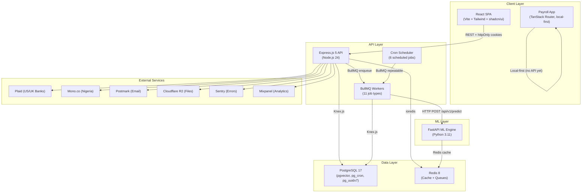

### 3.2 Monorepo Structure

```
accountable-books/
├── apps/
│   ├── api/                    # Express.js backend — 30+ domain modules
│   ├── web/                    # React SPA — features + modules architecture
│   ├── ml-engine/              # Python FastAPI — categorization ML
│   ├── web-payroll/            # Payroll frontend — TanStack Router, local-first
│   └── demo/                   # Demo data management CLI
├── packages/
│   ├── contracts/              # Shared Zod schemas + generated Pydantic models
│   └── utils/                  # Shared TS utilities (env management)
├── infra/
│   ├── makefiles/              # Modular Make rules (api, db, ml, web)
│   ├── monitoring/             # Observability config
│   ├── nginx/                  # Nginx config (staging web)
│   └── postgres/               # PostgreSQL Docker customization
├── docs/                       # Architecture, accounting logic, deployment
├── scripts/                    # Utility scripts
├── .github/workflows/          # CI/CD (quality, test, deploy-staging)
└── .husky/                     # Git hooks (pre-commit, pre-push)
```

**Orchestration:** Turbo v2.7.3 with pnpm 10.15.1 workspaces

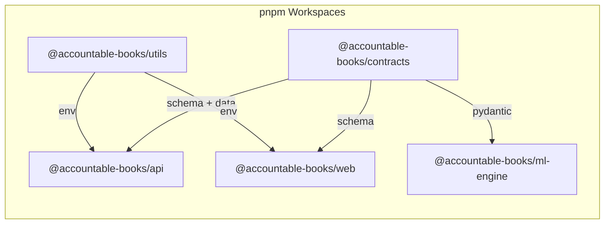

### 3.3 Technology Stack

| Layer               | Technology                           | Version                                    |
| ------------------- | ------------------------------------ | ------------------------------------------ |
| Runtime             | Node.js                              | >= 24.0.0                                  |
| Package Manager     | pnpm                                 | 10.15.1                                    |
| Build Orchestration | Turbo                                | 2.7.3                                      |
| API Framework       | Express.js                           | 5.1.0                                      |
| ORM / Query Builder | Knex.js                              | 3.1.0                                      |
| Database            | PostgreSQL                           | 17 (pgvector, pg_cron, pg_uuidv7, pg_trgm) |
| Cache / Queues      | Redis + BullMQ                       | 8.0 / 5.58.5                               |
| Validation          | Zod                                  | 4.1.5                                      |
| Frontend            | React                                | 18.2.0                                     |
| Frontend Build      | Vite                                 | 6.0.11                                     |
| CSS                 | Tailwind CSS                         | 4.1.4                                      |
| UI Components       | shadcn/ui (Radix primitives)         | Latest                                     |
| Client State        | Zustand                              | 5.0.3                                      |
| Server State        | React Query                          | 5.74.3                                     |
| Forms               | React Hook Form + Zod                | 7.62.0                                     |
| Frontend Routing    | React Router                         | 7.8.2                                      |
| ML Framework        | FastAPI                              | 0.115.0                                    |
| ML Models           | scikit-learn + sentence-transformers | 1.5.0 / 5.1.2                              |
| Testing (TS)        | Vitest                               | 4.0.16                                     |
| Testing (Python)    | pytest                               | Latest                                     |
| TypeScript          | TypeScript                           | 5.9.2                                      |

### 3.4 Data Flow: Transaction to Ledger

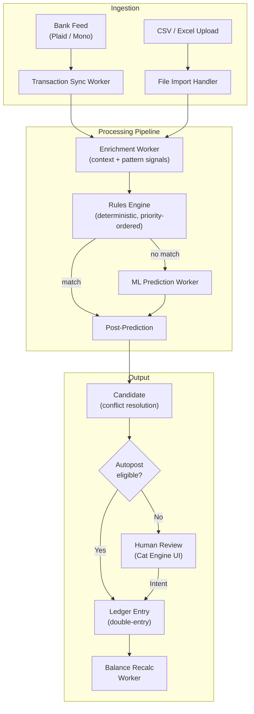

---

## 4. Backend API

### 4.1 Domain-Driven Architecture

The API uses a domain-driven folder structure under `apps/api/src/domains/`. Each domain is self-contained.

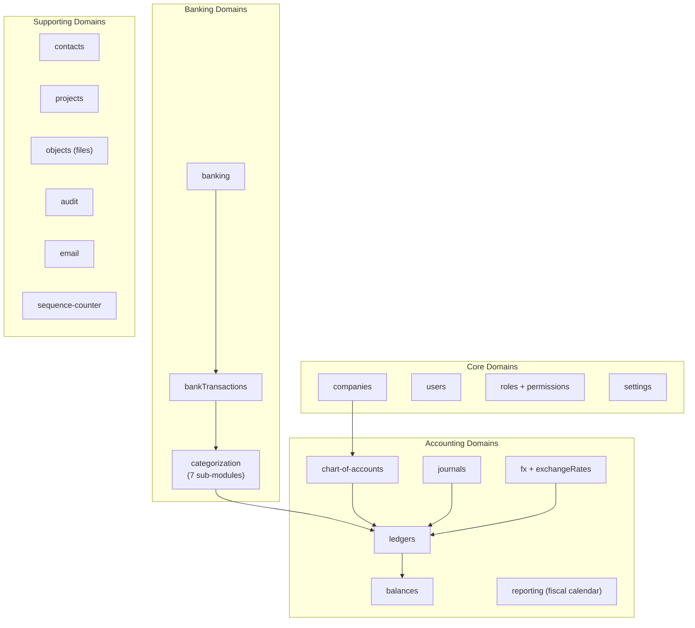

**Domain file convention:**

```
domains/<name>/
├── <name>.model.ts          # Data access (queries, mutations)
├── <name>.controller.ts     # HTTP request handlers
├── <name>.routes.ts         # Express route definitions
├── <name>.types.ts          # Zod schemas + TypeScript types
├── <name>.utils.ts          # Business logic helpers
└── <name>.service.ts        # Orchestration logic (optional)
```

**Key domains:**

| Domain              | Purpose                     | Key Operations                                               |
| ------------------- | --------------------------- | ------------------------------------------------------------ |
| `companies`         | Workspace/tenant management | Create, switch, onboarding state machine                     |
| `ledgers`           | Double-entry bookkeeping    | Create/update records, FX handling, advisory locks           |
| `journals`          | Manual journal entries      | Draft/post/void/reverse batches, recurring templates, import |
| `chart-of-accounts` | Account structure           | CRUD, templates, versioning, ML snapshots                    |
| `categorization`    | Transaction classification  | Enrichment, rules, ML, candidates, autopost, intents, stats  |
| `banking`           | Bank connections            | Plaid/Mono link, sync, webhooks, account classification      |
| `bankTransactions`  | Transaction management      | Import, sync trigger, soft delete                            |
| `balances`          | Balance calculations        | GL + bank daily/period/current snapshots                     |
| `contacts`          | Contact management          | CRUD, stats tracking, categorization correlation             |
| `fx`                | Foreign exchange            | Rate resolution, FX position tracking                        |
| `reporting`         | Fiscal calendar             | Period status, auto-extend, period locking                   |
| `settings`          | Company settings            | Type-safe registry, autopost config, FX settings             |

### 4.2 Authentication and Authorization

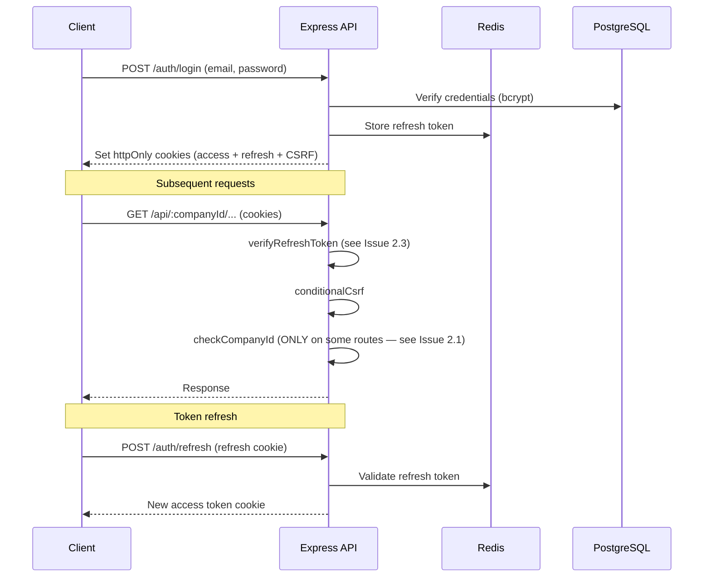

**Token configuration:**

| Token         | Expiry        | Storage                              |
| ------------- | ------------- | ------------------------------------ |
| Access token  | 15 minutes    | httpOnly cookie                      |
| Refresh token | 7 days        | httpOnly cookie + Redis              |
| CSRF token    | Session-bound | Double-submit cookie via `csrf-csrf` |

**RBAC model:** `roles` → `role_permissions` → `permissions`. Checked via `getPermissionsForRole(roleId)`.

**Route topology:**

```
/auth/*                                  # Public: login, signup, refresh, logout
/api/currencies, /api/countries          # Public: reference data
/api/email, /api/accounts/...            # Public: specific utilities
/                                        # Public: Plaid webhooks

/api/onboarding, /api/companies, ...     # Protected: verifyRefreshToken only
/api/:companyId/*                        # Protected: verifyRefreshToken (+ checkCompanyId on SOME routes)

/admin/queues                            # Admin: HTTP Basic Auth (Bull Board)
/api-docs                                # Public: Swagger
```

### 4.3 Database and ORM

**PostgreSQL 17** with extensions: `pgvector` (embeddings), `pg_cron` (scheduling), `pg_uuidv7` (time-ordered UUIDs), `pg_trgm` (fuzzy text search), `pgcrypto`, `citext`, `unaccent`.

**Core ORM patterns:**

```typescript
// Transaction pattern — most model functions accept optional trx
async function createSomething({
  input,
  companyId,
  trx,
}: {
  input: InputType;
  companyId: string;
  trx?: Knex.Transaction;
}) {
  const fn = async (knex: Knex.Transaction) => {
    /* work */
  };
  return trx ? fn(trx) : knexClient.transaction(fn);
}
```

**Key database patterns:**

- **Advisory locks** prevent concurrent mutations on the same entity (ledger, categorization)
- **Partitioned tables** for `ledger_entries` and `bank_transactions` (date-based, with maintenance cron)
- **Soft deletes** (`is_deleted` flag) throughout — no hard deletes
- **snake_case** columns, converted to **camelCase** at application boundaries via `camelToSnake()`/`snakeToCamel()`
- **74 migration files** covering the full schema (see Section 9.3)

### 4.4 Job Queue and Worker System

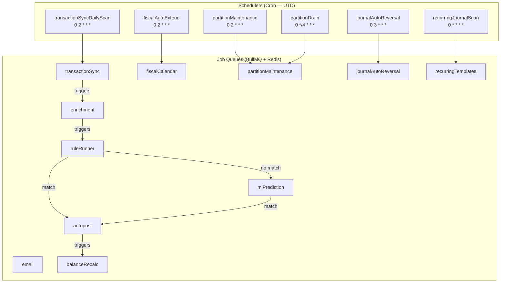

**Process topology:** Three separate OS processes (gated by `FLY_PROCESS_GROUP`):

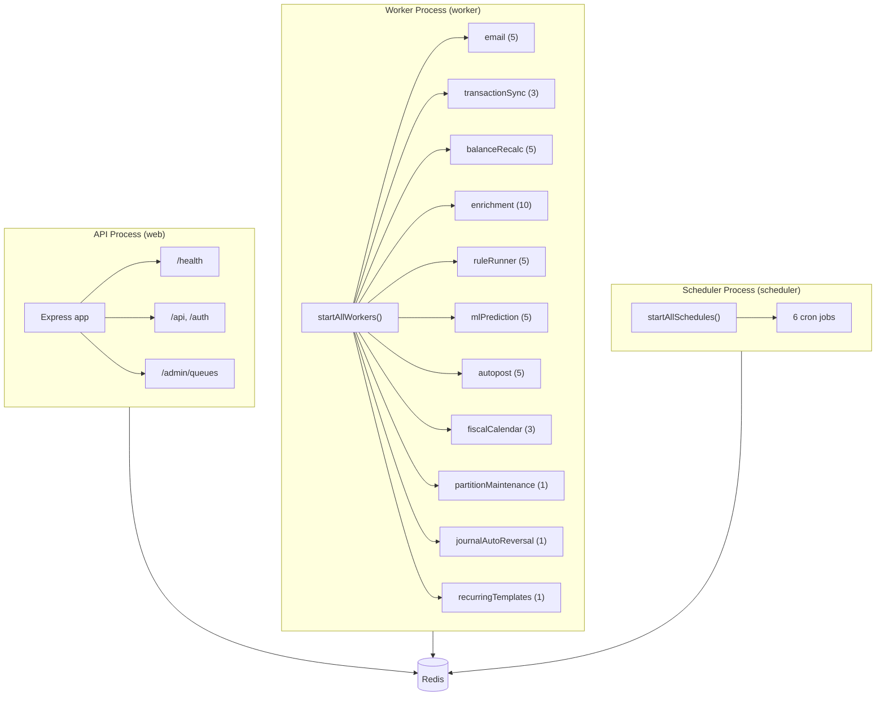

Numbers in parentheses are default concurrency (all configurable via env).

**Queue patterns:**

- Priority-based processing (manual > automatic triggers)
- Job deduplication via composite job IDs (e.g., `gl-{companyId}-{coaId}`)
- Range merging for balance recalculation (extends date ranges instead of duplicating)
- Retry: 3 attempts with exponential backoff (5s base delay)
- Graceful shutdown on SIGTERM/SIGINT
- Queue broker can disable execution in test environments

### 4.5 Error Handling

**Standard API response:**

```typescript
interface ApiResponse<T> {
  success: boolean;
  message: string;
  data?: T;
  code?: ErrorCode;
  error?: string | Record<string, unknown> | string[];
}
```

**Error codes:** `INVALID_CREDENTIALS`, `UNAUTHORIZED`, `FORBIDDEN`, `INVALID_INPUT`, `CONFLICT`, `NOT_FOUND`, `OPERATION_NOT_ALLOWED`, `ONBOARDING_INCOMPLETE`, `GENERIC_ERROR`, `DATABASE_ERROR`, `SERVICE_UNAVAILABLE`.

**AppError class:** extends `Error` with `code: ErrorCode`, `details?: any`, `shouldReport: boolean` (controls Sentry reporting). Helpers: `successResponse()`, `errorResponse()`.

---

## 5. Categorization Engine

The categorization engine is the most complex subsystem. It transforms raw bank transactions into properly categorized ledger entries through a multi-stage async pipeline.

### 5.1 Pipeline Overview

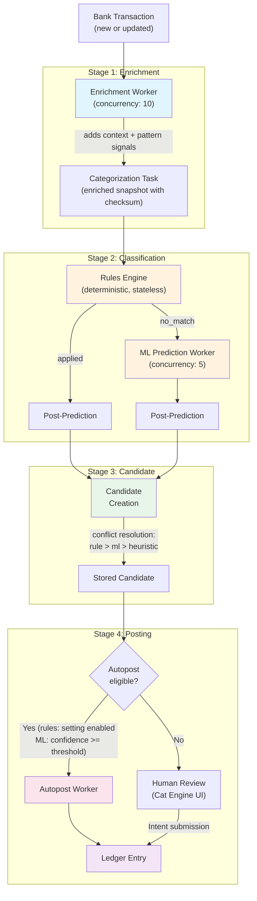

**Implementation locations:**

- Enrichment: `apps/api/src/domains/categorization/enrichment/*`
- Rules: `apps/api/src/domains/categorization/rules/*`
- ML orchestration: `apps/api/src/domains/categorization/ml/*`
- Post-prediction / candidates: `apps/api/src/domains/categorization/post-prediction/*`
- Autopost: `apps/api/src/domains/categorization/autopost/*`
- Tasks + events: `apps/api/src/domains/categorization/tasks/*`

### 5.2 Enrichment

**Location:** `apps/api/src/domains/categorization/enrichment/`

Transforms raw bank transactions into an `EnrichedTransaction` DTO:

| Feature Category       | Details                                                                                      |
| ---------------------- | -------------------------------------------------------------------------------------------- |
| Transaction data       | Description, amount, date, reference                                                         |
| Bank context           | COA mapping, currency, institution                                                           |
| Company context        | Fiscal calendar, country, region                                                             |
| Contact history        | Past categorizations, frequency, stats                                                       |
| Pattern signals        | `likely_split`, `likely_tax`, `likely_fx`, `likely_prepayment`, `is_recurring`, `is_anomaly` |
| Temporal features      | Fiscal month/quarter, day of week, period boundaries                                         |
| Description processing | Normalized, tokenized, MCC inference, cleansing                                              |

**Pattern detection** (from `enrichment.utils.ts`):

- Split: `SPLIT`, `PARTIAL`, `INSTALLMENT`
- Transfer: `TRANSFER`, `TRF`, `WALLET TOPUP`
- Tax: `VAT`, `TAX`, `WHT`, `PAYE`, `HMRC`, `IRS`
- FX: `FOREIGN EXCHANGE`, `FX`, `CURRENCY CONVERSION`
- Recurring: `SUBSCRIPTION`, `MONTHLY`, `ANNUAL`
- Anomaly: amounts > 1M

### 5.3 Rules Engine

**Location:** `apps/api/src/domains/categorization/rules/`

A deterministic, stateless rule processor with priority ordering.

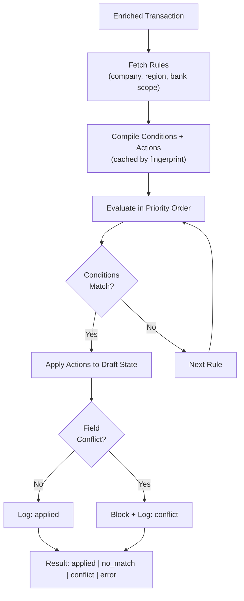

**Components:**

- **Conditions:** Transaction assertions (amount, description regex, payee, direction)
- **Actions:** Field mutations (assign COA, set description, contact, project)
- **Scopes:** Global, bank-account-specific, region-specific
- **Conflict prevention:** Exclusive field claims — higher-priority rules lock fields
- **Audit:** Every rule evaluation logged with conditions, actions, and conflicts

### 5.4 ML Prediction

**API side:** `apps/api/src/domains/categorization/ml/`
**ML service:** `apps/ml-engine/ml_engine/`

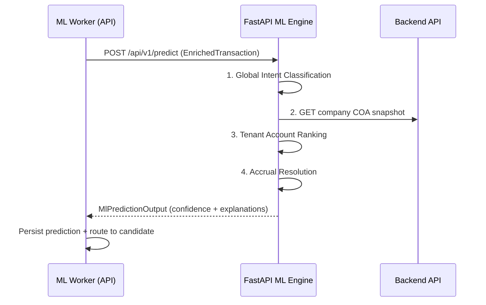

**Three ML models:**

1. **Global Intent Classifier** — predicts semantic account intent (e.g., `expense_office_supplies`)
2. **Tenant Account Ranker** — ranks company-specific COA entries by relevance
3. **Accrual Resolver** — determines accrual posting accounts

**Shadow mode:** ML can run alongside rules for validation/training without affecting production flow.

### 5.5 Candidates and Autoposting

**Candidate conflict resolution** (when multiple sources propose categorization):

| Scenario             | Winner                                                  |
| -------------------- | ------------------------------------------------------- |
| New source is `rule` | Always replaces existing                                |
| Same source          | Higher confidence wins                                  |
| Different source     | Higher rank wins (`rule`=3 > `ml`=2 > `ml_heuristic`=1) |
| Tie                  | Keep existing                                           |

All replacements are audit-logged with reasons.

**Autopost eligibility:**

| Source         | Condition                                                          |
| -------------- | ------------------------------------------------------------------ |
| Rules          | Company setting `autopost_rules` is enabled                        |
| ML / Heuristic | `autopost_ai` enabled AND confidence >= `min_confidence` threshold |

Delayed autoposting is supported via BullMQ with configurable `delay_minutes`.

### 5.6 Intent System

**Location:** `apps/api/src/domains/categorization/intent-registry.ts`

Users can override categorization decisions at any stage:

| Intent               | Description                                     |
| -------------------- | ----------------------------------------------- |
| `ASSIGN_COA`         | Assign chart of accounts entry                  |
| `UPDATE_DESCRIPTION` | Update description (transaction or entry level) |
| `UPDATE_FS_DATE`     | Update financial statement date                 |
| `UPDATE_CONTACT`     | Assign/change contact and type                  |
| `UPDATE_REFERENCE`   | Update reference                                |
| `UPDATE_PROJECT`     | Assign project                                  |
| `UPDATE_FX_RATE`     | Override custom exchange rate                   |
| `POST_TO_LEDGER`     | Post candidate to ledger                        |
| `SPLIT_TRANSACTION`  | Create split entries across COAs                |

**Intent merging** is chronological with nullable semantics:

- `undefined` = no change, use fallback
- `null` = explicit clear to null
- `value` = set/overwrite

**Three-phase processing:** detect current state (uncategorized / proposed / posted) → merge intents → execute state transition (build ledger entries).

---

## 6. Frontend Application

### 6.1 Architecture and Routing

**Location:** `apps/web/`

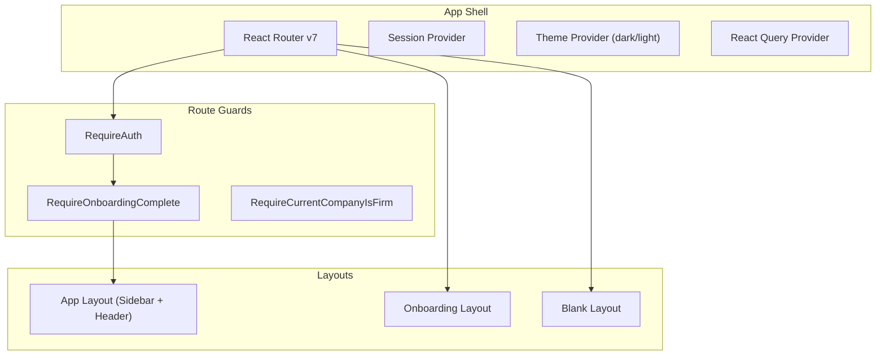

**Key routes (from route definitions, not docs):**

| Route Pattern                                  | Page                         | Guard             |
| ---------------------------------------------- | ---------------------------- | ----------------- |
| `/auth/login`                                  | Login                        | Public            |
| `/auth/signup`                                 | Signup flow                  | Public            |
| `/onboarding/:step`                            | Onboarding wizard            | RequireAuth       |
| `/banking/plaid-oauth`                         | Plaid OAuth callback         | Public            |
| `/:companyId/dashboard`                        | Dashboard                    | Auth + Onboarding |
| `/:companyId/ws/accounting`                    | Accounting workspace         | Auth + Onboarding |
| `/:companyId/ws/accounting/cat-engine`         | Categorization engine        | Auth + Onboarding |
| `/:companyId/ws/accounting/transactions`       | Transactions view            | Auth + Onboarding |
| `/:companyId/ws/accounting/journals`           | Journal management           | Auth + Onboarding |
| `/:companyId/ws/accounting/journals/recurring` | Recurring templates          | Auth + Onboarding |
| `/:companyId/ws/accounting/coa`                | Chart of Accounts            | Auth + Onboarding |
| `/:companyId/ws/accounting/setup`              | Accounting setup             | Auth + Onboarding |
| `/:companyId/banking/connect`                  | Bank connection (Plaid/Mono) | Auth + Onboarding |
| `/:companyId/banking/upload`                   | Transaction file upload      | Auth + Onboarding |

**Not found in route definitions:** Any route for financial reports (P&L, Balance Sheet, Trial Balance). See Product Gaps (Section 12.4).

### 6.2 State Management

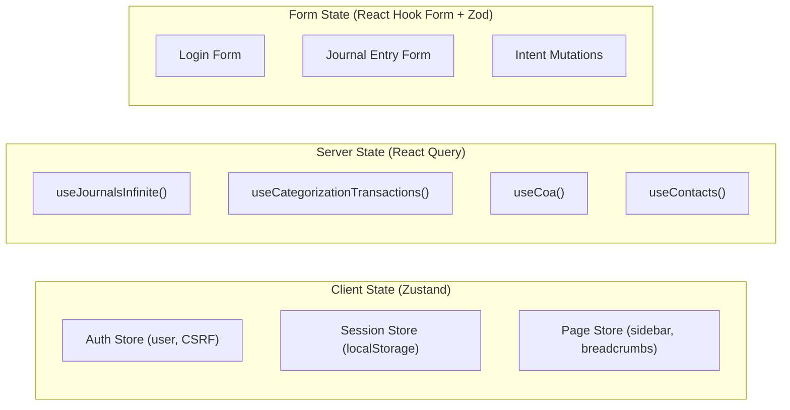

**Module structure:**

```
modules/<domain>/
├── api/index.ts         # Axios service functions
├── model/
│   ├── hooks.ts         # React Query hooks
│   ├── types.ts         # Domain types
│   └── store.ts         # Zustand store (if needed)
└── index.ts             # Barrel exports
```

### 6.3 Key Features

**Categorization Engine (Cat Engine):**

- Transaction list with real-time account mapping
- Filtering by status (uncategorized/proposed/posted), date, bank account, search
- Editable cells for COA assignment
- Batch operations, split transaction support

**Journal Management:**

- Infinite scroll with cursor-based pagination and virtual list rendering
- Detail pane for viewing/editing
- Status filtering (draft/posted/voided)
- Recurring journal template management
- Batch import with preflight validation

**Bank Connection:**

- Plaid Link integration (US/UK), Mono.co integration (Nigeria)
- CSV/Excel file upload as alternative
- Transaction sync status monitoring, account classification to COA

**Design system:** shadcn/ui + Tailwind CSS v4, TanStack Table v8 (with virtual scrolling), Recharts, Sonner (toasts), Motion (animations).

### 6.4 Authentication Flow

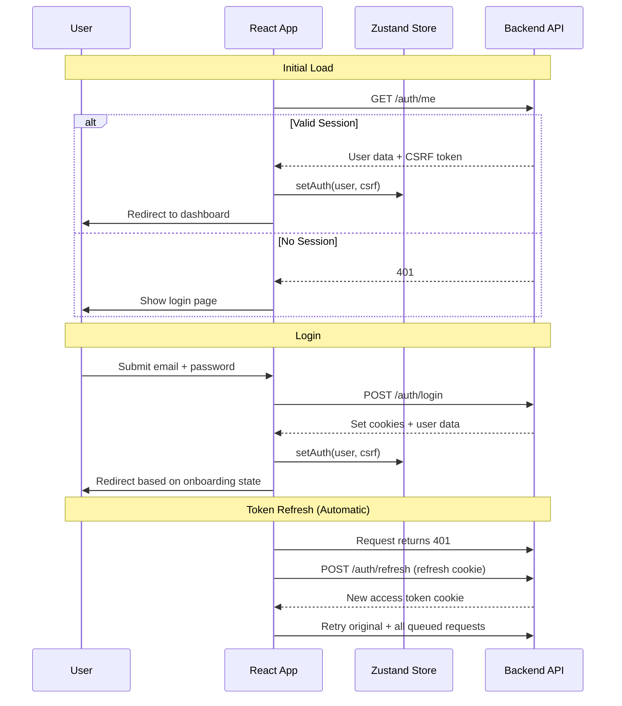

**Token refresh queueing:** Axios interceptor queues all subsequent requests during refresh to prevent race conditions. Tracks logout reason: `manual`, `expired`, `forced`.

---

## 7. ML Engine Service

**Location:** `apps/ml-engine/`

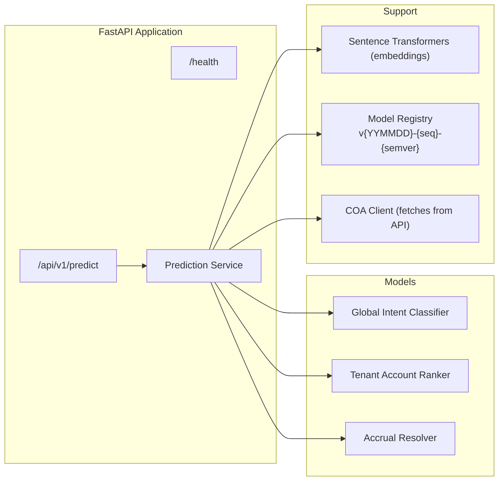

**Input:** `EnrichedTransaction` (from `@accountable-books/contracts`)
**Output:** `MlPredictionOutput` with confidence scores, explanations, and token-level attributions

**Pipeline:** Global intent classification → fetch company COA (with default fallback) → tenant account ranking → accrual resolution → return predictions.

**Model artifacts:** Stored under `ml_engine/models/*/artifacts/`, configs under `configs/`. Registry manages status: `active`, `deprecated`, `experimental`.

---

## 8. Shared Packages

### `@accountable-books/contracts`

Single source of truth for API contracts across TypeScript and Python.

**Exports:**

- `./schema` — Zod schemas (categorization, journals, accounting, common enums)
- `./data` — Pre-generated account type definitions (100+ types across 7 categories)
- `./pydantic` — Generated Python Pydantic models for ML engine

**Account type taxonomy:**

```
Current Assets      → Bank, Cash, Inventory, AR, Prepayments...
Non-Current Assets  → Land, PPE, Intangibles, Investments...
Current Liabilities → AP, Payroll, Accruals, Tax, Short-term Debt...
Non-Current Liabilities → Long-term Debt, Leases...
Equity              → Contributed Capital, Retained Earnings, OCI...
Income              → Revenue, Finance Income, Other Income
Expenses            → COGS, OPEX categories, Finance Costs, Tax
```

**Label roles** (controls categorization behavior):

- `semantic` — business concepts, trainable by ML
- `mechanical` — system-generated, not trainable
- `control` — template/posting flow accounts
- `fallback` — catch-all for ambiguous transactions

**Key shared enums:** `CompanyType` (business, individual, accounting_firm), `ReportingFramework` (ifrs, us_gaap), `ContactType` (10 values), `JournalBatchStatus` (draft, posted, voided), `RecurringTemplateStatus` (draft, active, paused, closed), `RecurrenceFrequency` (daily, weekly, monthly, yearly).

### `@accountable-books/utils`

Environment management: type-safe schema definitions, multi-environment file generation (local, staging, production), secure secret generation, CLI for developer setup.

---

## 9. Infrastructure and DevOps

### 9.1 Deployment Architecture

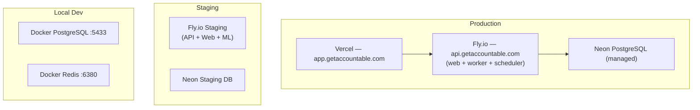

**Topology:**

- **API:** Fly.io, 3 process groups (`web`, `worker`, `scheduler`), region `iad`
- **Web:** Vercel (production), Nginx on Fly.io (staging)
- **ML Engine:** Fly.io (staging), production TBD
- **Database:** Neon PostgreSQL (managed)
- **Scheduler:** Gated by `FLY_PROCESS_GROUP === 'scheduler'` + `ENABLE_SCHEDULER` — ensure single instance to avoid cron duplication

### 9.2 CI/CD Pipeline

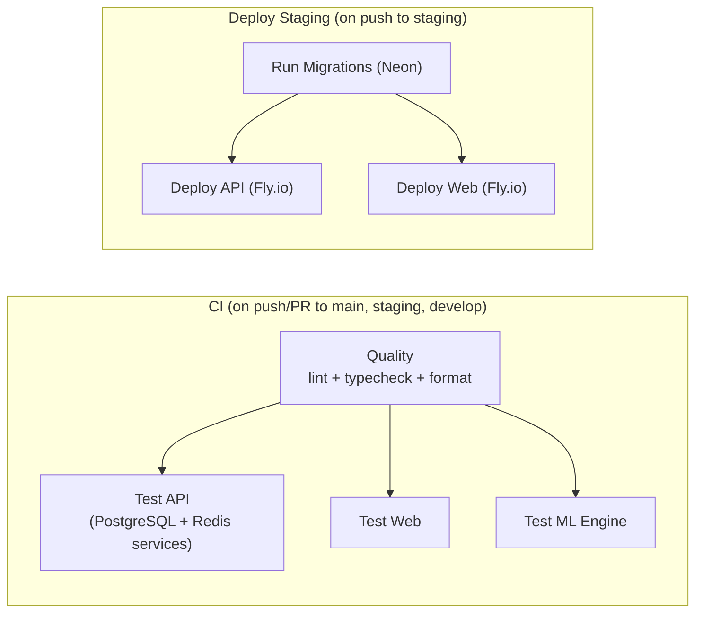

**Git hooks:**

- `pre-commit` — lint-staged (lint + format changed files)
- `pre-push` — typecheck + build + test

### 9.3 Database Migrations

74 migrations organized by category:

| Category       | Count | Key Tables                                                                                                                                                    |
| -------------- | ----- | ------------------------------------------------------------------------------------------------------------------------------------------------------------- |
| Core setup     | 5     | Extensions, enums, triggers, indexes, cron functions                                                                                                          |
| User / Auth    | 4     | users, roles, permissions, tokens                                                                                                                             |
| Company        | 3     | companies, company_settings, firm_assignments                                                                                                                 |
| Accounting     | 8     | coa, ledger_transactions, ledger_entries (partitioned), journal_batches, journal_entries, recurring_templates                                                 |
| Banking        | 7     | banks, bank_accounts, bank_account_credentials, bank_transactions (partitioned), bank_transaction_batches                                                     |
| Categorization | 8     | categorization_predictions, categorization_candidates, categorization_candidate_lines, categorization_tasks, categorization_task_events                       |
| Rules          | 4     | rules, rule_conditions, rule_actions, rule_logs                                                                                                               |
| Balances       | 7     | gl_current_balances, gl_daily_balance_snapshots, gl_period_balances, bank_current_native_balances, bank_daily_native_snapshots, bank_account_opening_balances |
| FX             | 2     | exchange_rates, fx_positions                                                                                                                                  |
| Files          | 2     | files, file_attachments                                                                                                                                       |
| Views          | 2     | bank_accounts_metrics_view, cat_engine_view                                                                                                                   |
| Other          | 22    | contacts, projects, audit_events, ledger_audit_logs, sequence_counters, transaction_vectors, coa_versioning, contact_stats, etc.                              |

### Entity Relationship Overview

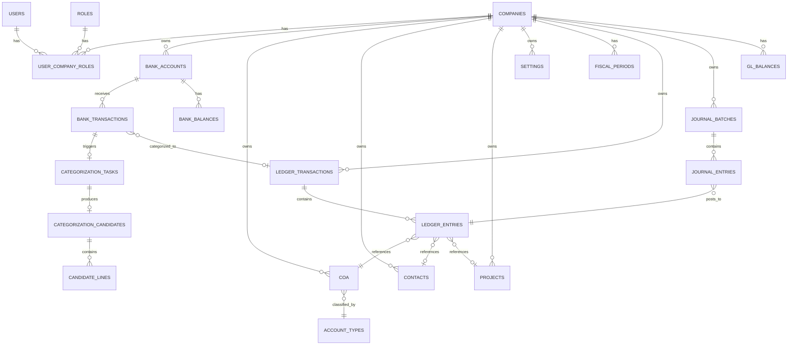

---

## 10. Code Health Audit

All findings in this section are verified against source code with file paths and line numbers.

### 10.1 Verified Bugs

**Bug: Industry field assignment (operator precedence)**

- **File:** `apps/api/src/domains/companies/companies.model.ts:299-302`
- **Severity:** Medium
- **Description:** Due to JS operator precedence (`===` > `||` > `?:`), any company with a truthy `industry` value gets overwritten to `'professional_services'` instead of keeping its original industry. Only companies with falsy `industry` AND non-accounting-firm type get `null`.
- **Fix:** Add parentheses: `sanitizedData.industry || (sanitizedData.type === 'accounting_firm' ? 'professional_services' : null)`

### 10.2 Dead and Stale Code

**Dead file: TransactionServices.ts**

- **File:** `apps/web/src/shared/services/TransactionServices.ts` (65 lines)
- **Evidence:** Zero imports found across the entire `apps/web/src` directory
- **Detail:** Uses raw `axios` (not the app's configured instance), references non-existent endpoints like `/api/:companyId/t`, imports `qs` for param serialization. This is legacy code predating the current `modules/` architecture.
- **Action:** Delete the file.

**Stale frontend modules: `domains-pending-migration/`**

- **Location:** `apps/web/src/domains-pending-migration/`
- **17 directories** still present: `account-classification`, `accounting-setup`, `accounting-ws`, `bankConnection`, `bankFeedProviders`, `cat-engine`, `company`, `dashboard`, `financial-settings`, `firms`, `objects`, `onboarding`, `permissions`, `signup`, `spreadsheets`, `switchCompany`, `user`
- **Impact:** Some are still referenced in the route tree. Increases cognitive load and makes it unclear which code is authoritative.
- **Action:** Audit each directory, migrate remaining active references, and delete.

**Commented-out code in app.ts**

- **File:** `apps/api/src/app.ts:80-94`
- **Detail:** 15 lines of commented-out `console.error` override code. Should be removed or moved to a debug utility.

### 10.3 Logging Inconsistency

**Finding:** The API codebase uses two incompatible logging approaches simultaneously.

| Approach                 | Files    | Occurrences |
| ------------------------ | -------- | ----------- |
| `console.log/warn/error` | 43 files | 159 total   |
| Pino (structured logger) | 21 files | 22 imports  |

**High-impact examples of `console.log` in production paths:**

- `apps/api/src/domains/banking/banking.controller.ts` — 9 occurrences
- `apps/api/src/jobs/workers/index.ts` — 15 occurrences
- `apps/api/src/shared/services/partitionManagement.service.ts` — 12 occurrences
- `apps/api/src/jobs/workers/partition-maintenance.worker.ts` — 11 occurrences
- `apps/api/src/features/communications/email/email.service.ts` — 9 occurrences
- `apps/api/src/features/communications/email/email.worker.ts` — 7 occurrences

**Impact:** `console.log` output lacks structure, timestamps, log levels, and trace context that Pino provides. In production on Fly.io, unstructured logs are harder to query and alert on.

**Action:** Standardize on Pino. A shared `logger.ts` already exists at `apps/api/src/shared/utils/logger.ts`. Prioritize the high-traffic workers and banking controller first.

### 10.4 Test Coverage Assessment

| App           | Test Files | Domains Covered                                                                                                                     | Notable Gaps                                                                          |
| ------------- | ---------- | ----------------------------------------------------------------------------------------------------------------------------------- | ------------------------------------------------------------------------------------- |
| **API**       | 30         | constraints (6), journals (5), ledgers (2), enrichment (2), audit (1), userRoles (1), seeds (9), health (1), contact heuristics (1) | Banking controller, categorization intents, autopost, rules engine, settings, COA, FX |
| **Web**       | 4          | banking integration (1), journal actions (1), company switcher (1), simple (1)                                                      | Cat engine UI, auth flows, onboarding, most features                                  |
| **ML Engine** | 7          | prediction service, model registry, embeddings, feature maps, health, account data, model integration                               | End-to-end with real enriched data                                                    |
| **Payroll**   | 4          | PAYE computation (1), payroll run (1), YTD extraction (1), comp history (1)                                                         | UI, storage, employee management                                                      |

**Key gap:** No end-to-end test covers the full path: bank transaction → enrichment → rules/ML → candidate → intent → ledger posting → balance recalculation. This is the critical business workflow.

**Positive coverage:** Constraint validators (debits = credits, COA exists, period not locked, project exists) are well-tested. Journal command operations (create, post, void, reverse, import) have thorough tests. Ledger model tests cover manual journals, bank transactions, splits, and FX.

---

## 11. Conventions and Patterns

### Code Patterns

| Pattern              | Convention                                                             | Location               |
| -------------------- | ---------------------------------------------------------------------- | ---------------------- |
| Transaction wrapping | All DB mutations accept optional `trx` parameter                       | All models             |
| Validation           | Zod `safeParse()` at controller entry                                  | Controllers            |
| Response format      | `successResponse()` / `errorResponse()` helpers                        | `response.utils.ts`    |
| Logging              | Pino child loggers with operation context (intended)                   | Services/workers       |
| Case conversion      | `camelToSnake()` / `snakeToCamel()` at boundaries                      | `formatting.utils.ts`  |
| Soft deletes         | `is_deleted` flag, never hard delete                                   | All tables             |
| Advisory locks       | Prevent concurrent mutations on same entity                            | Ledger, categorization |
| Queue deduplication  | Composite job IDs prevent duplicates                                   | All queues             |
| Feature modules (FE) | `ui/` + `model/` + `api/` per feature                                  | Frontend features      |
| Idempotency          | Check existing ledger for same `source_transaction_id` before creating | Ledger creation        |

### Naming Conventions

| Type               | Convention                                | Example                         |
| ------------------ | ----------------------------------------- | ------------------------------- |
| Files              | kebab-case                                | `journal-batch.ts`              |
| DB columns         | snake_case                                | `company_id`                    |
| TS variables       | camelCase                                 | `companyId`                     |
| Types / Interfaces | PascalCase                                | `JournalBatch`                  |
| Zod schemas        | camelCase                                 | `journalBatchInput`             |
| API routes         | kebab-case                                | `/api/:companyId/bank-accounts` |
| Queue names        | camelCase                                 | `balanceRecalc`                 |
| Environment vars   | SCREAMING_SNAKE                           | `JWT_ACCESS_SECRET`             |
| ML model versions  | `v{YYMMDD}-{seq}-{major}.{minor}.{patch}` | `v260101-01-1.0.0`              |

### Testing Conventions

| Convention            | Detail                                                       |
| --------------------- | ------------------------------------------------------------ |
| API integration tests | Real PostgreSQL, transaction rollback isolation per test     |
| Web component tests   | jsdom environment, React Testing Library                     |
| ML tests              | pytest with async support                                    |
| Test helpers          | Demo data factories in `apps/api/test/helpers.ts`            |
| Global setup          | Migrations run once before suite via `test/global-setup.js`  |
| Test DB               | Separate `{POSTGRES_DB}_test` database, created idempotently |

---

## 12. Product Analysis

### 12.1 Feature Map

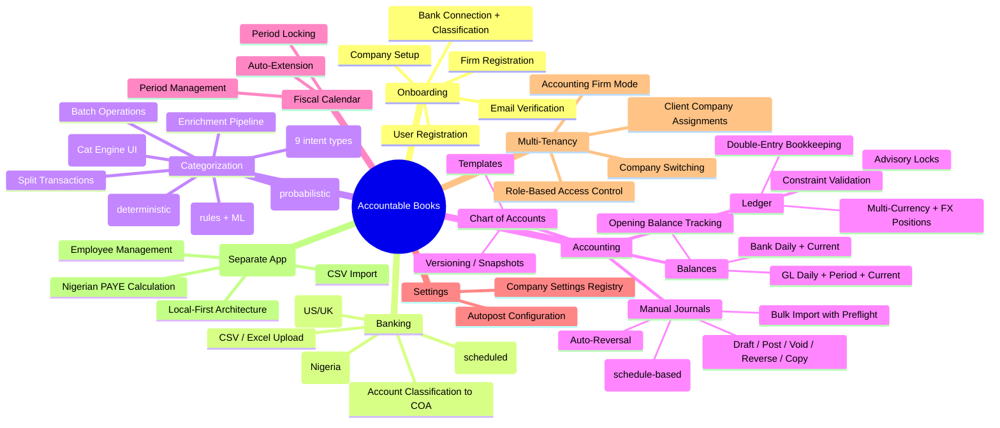

### 12.2 User Flows

**Primary flow: Bank transaction to ledger entry**

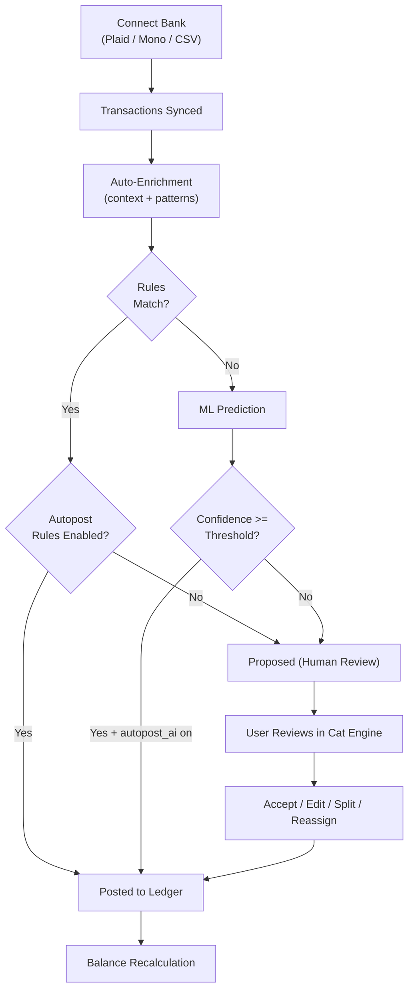

**Onboarding flow:**


**Journal lifecycle:**

```mermaid
flowchart LR
    CREATE["Create Draft<br/>Journal Batch"] --> POST["Post<br/>(creates ledger entries)"]
    POST --> VOID["Void<br/>(marks cancelled)"]
    POST --> REVERSE["Reverse<br/>(creates offsetting entries)"]
    CREATE --> IMPORT["Bulk Import<br/>(with preflight validation)"]
    POST --> BALANCE["Balance Recalc<br/>+ Audit Log"]
```

### 12.3 Multi-Tenancy Model

```mermaid
graph TB
    subgraph "Accounting Firm"
        FIRM["Firm Company<br/>(type: accounting_firm)"]
        STAFF["Firm Staff"]
    end

    subgraph "Client Companies"
        C1["Client A (business)"]
        C2["Client B (individual)"]
        C3["Client C (business)"]
    end

    STAFF -->|"manage"| FIRM
    FIRM -->|"assigned"| C1
    FIRM -->|"assigned"| C2
    FIRM -->|"assigned"| C3
    STAFF -->|"switch context"| C1
    STAFF -->|"switch context"| C2
    STAFF -->|"switch context"| C3
```

- Company types: `business`, `individual`, `accounting_firm`
- Users belong to companies via `user_company_roles` (many-to-many with role)
- Context switching via `switchCompany()` endpoint
- Platform firm auto-assigned on company creation

### 12.4 Product Gaps

These gaps are verified by searching route definitions, controller files, and frontend routes.

| Gap                                                                    | Evidence                                                                                                                                | Severity                      |
| ---------------------------------------------------------------------- | --------------------------------------------------------------------------------------------------------------------------------------- | ----------------------------- |
| **No financial statements UI/API** (P&L, Balance Sheet, Trial Balance) | No route, controller, or frontend page found. Backend has `gl_period_balances` and fiscal infrastructure, but no reporting endpoint.    | **High** — likely MVP blocker |
| **No dedicated reporting route**                                       | Frontend route definitions (`shared/routes/definitions/`) contain no reporting section. `sidebarData.ts` has no reports entry.          | High                          |
| **Payroll not integrated with core ledger**                            | `apps/web-payroll` is local-first (client-side storage via `payroll-storage.ts`). No API sync, no journal generation from payroll runs. | Medium — depends on roadmap   |
| **No feature flags**                                                   | No feature flag system found. Risky for gradual rollout of new features.                                                                | Low                           |
| **No explicit ML feedback loop**                                       | User corrections via intents exist, but no mechanism to retrain or fine-tune tenant models based on corrections.                        | Medium                        |

---

## 13. Prioritized Roadmap

### Immediate (0-14 days)

| #   | Action                                                            | Type         | Files                                                 |
| --- | ----------------------------------------------------------------- | ------------ | ----------------------------------------------------- |
| 1   | Apply `checkCompanyId` globally to all `/api/:companyId/*` routes | **Security** | `app.ts`                                              |
| 2   | Fix industry ternary precedence bug + add regression test         | **Bug fix**  | `companies.model.ts:299`                              |
| 3   | Delete dead `TransactionServices.ts`                              | **Cleanup**  | `apps/web/src/shared/services/TransactionServices.ts` |
| 4   | Remove commented-out code in `app.ts`                             | **Cleanup**  | `app.ts:80-94`                                        |
| 5   | Document auth trust model (refresh vs access token strategy)      | **Security** | `auth.middleware.ts`, `app.ts`                        |

### Short-term (14-30 days)

| #   | Action                                                                                     | Type              | Files                                                         |
| --- | ------------------------------------------------------------------------------------------ | ----------------- | ------------------------------------------------------------- |
| 6   | Standardize logging on Pino in top 10 highest-`console.log` files                          | **Observability** | Banking controller, workers, email service, partition service |
| 7   | Add end-to-end smoke test: ingest → enrich → rules → candidate → intent → ledger → balance | **Testing**       | New test file                                                 |
| 8   | Add integration tests for categorization intents and autopost eligibility                  | **Testing**       | New test files                                                |
| 9   | Audit `domains-pending-migration/` — migrate active refs, delete rest                      | **Cleanup**       | 17 directories                                                |
| 10  | Ensure scheduler runs as a single instance (document Fly.io config)                        | **Operations**    | `fly.production.toml`, deployment docs                        |

### Medium-term (30-60 days)

| #   | Action                                                                  | Type           | Files                                        |
| --- | ----------------------------------------------------------------------- | -------------- | -------------------------------------------- |
| 11  | Build reporting API: Trial Balance, P&L, Balance Sheet                  | **Product**    | New domain: `reporting/financial-statements` |
| 12  | Build reporting frontend routes and UI                                  | **Product**    | New routes + feature module                  |
| 13  | Complete frontend migration off `domains-pending-migration`             | **Tech debt**  | 17 directories → 0                           |
| 14  | Add queue monitoring dashboards (lag, retries, per-stage failure rates) | **Operations** | Bull Board or custom                         |
| 15  | Standardize auth enforcement with explicit access token verification    | **Security**   | Auth middleware                              |

### Strategic (60-120 days)

| #   | Action                                                                  | Type             | Files                      |
| --- | ----------------------------------------------------------------------- | ---------------- | -------------------------- |
| 16  | Define bounded contexts for future service decomposition                | **Architecture** | ADR document               |
| 17  | Formalize ML model lifecycle (versioning policy, shadow eval, rollback) | **ML Ops**       | ML engine config           |
| 18  | Decide payroll-ledger integration strategy                              | **Product**      | Payroll app + API          |
| 19  | Implement feature flag system for gradual rollouts                      | **Platform**     | New shared utility         |
| 20  | Build ML feedback loop from user intent corrections                     | **ML**           | Categorization + ML engine |

---

## 14. Quick Reference

### Development Commands

```bash
# Setup
make setup                    # One-command full setup
make dev                      # Start all services (API + Web + Docker)
make dev-api                  # Start API only
make dev-web                  # Start Web only
make dev-ml                   # Start ML engine

# Database
make db-up                    # Start PostgreSQL + Redis (Docker)
make db-migrate               # Run Knex migrations
make db-seed                  # Seed demo data
make db-reset                 # Full database reset
make db-shell                 # Connect to psql

# Quality
make check                    # Lint + typecheck + format check
pnpm lint                     # ESLint
pnpm format                   # Prettier
pnpm typecheck                # TypeScript type check
pnpm test                     # All tests (API + Web + ML)

# Contracts
pnpm gen:contracts            # Regenerate shared Zod/Pydantic schemas

# Demo Data
make demo                     # Apply demo data
make demo-status              # Show demo status
```

### Key File Paths

| File                                                                | Purpose                                      |
| ------------------------------------------------------------------- | -------------------------------------------- |
| `apps/api/src/app.ts`                                               | API entry: middleware chain + route mounting |
| `apps/api/src/worker.ts`                                            | Worker process entry + health checks         |
| `apps/api/src/scheduler.ts`                                         | Scheduler process entry                      |
| `apps/api/src/jobs/registry.ts`                                     | All 11 worker definitions with concurrency   |
| `apps/api/src/jobs/schedules.ts`                                    | All 6 cron schedule definitions              |
| `apps/api/src/domains/`                                             | All 30+ domain modules                       |
| `apps/api/src/features/auth/auth.middleware.ts`                     | Auth middleware (JWT, CSRF)                  |
| `apps/api/src/core/middlewares/companies.middleware.ts`             | `checkCompanyId` middleware                  |
| `apps/api/src/shared/utils/response.utils.ts`                       | API response helpers + AppError              |
| `apps/api/src/shared/utils/logger.ts`                               | Pino logger factory                          |
| `apps/api/src/domains/categorization/`                              | Full categorization pipeline (7 sub-modules) |
| `apps/api/src/domains/ledgers/ledgers.model.ts`                     | Core ledger creation logic                   |
| `apps/api/src/domains/journals/journals.command.ts`                 | Journal lifecycle operations                 |
| `apps/web/src/app/router/`                                          | Frontend routing and guards                  |
| `apps/web/src/modules/auth/session/`                                | Session management (Zustand + React Query)   |
| `apps/web/src/features/cat-engine/`                                 | Categorization engine UI                     |
| `apps/web/src/features/manage-journals/`                            | Journal management UI                        |
| `apps/ml-engine/ml_engine/main.py`                                  | ML engine entry point                        |
| `apps/ml-engine/ml_engine/domains/prediction/prediction_service.py` | Prediction pipeline                          |
| `packages/contracts/`                                               | Shared schemas (Zod + Pydantic)              |
| `packages/utils/src/env/`                                           | Environment management utilities             |
| `turbo.json`                                                        | Build orchestration config                   |
| `docker-compose.dev.yml`                                            | Local infrastructure (PostgreSQL + Redis)    |
| `.github/workflows/ci.yml`                                          | CI pipeline definition                       |
| `Makefile`                                                          | Development command hub                      |

### Open Questions for the Team

1. Is the refresh-token-for-all-routes auth pattern deliberate, or should it be access-token-first?
2. Are there company-scoped routes that intentionally allow cross-company access (e.g., admin tooling)?
3. What is the target timeline for financial statements (P&L, Balance Sheet) in the UI?
4. Should the payroll app sync into the core ledger, and if so, on what timeline?
5. What is the intended policy for autopost confidence thresholds by company segment (SMB vs firm-managed)?
6. Is there a plan for ML model retraining based on user intent corrections?

---

_Generated from direct code inspection. Every finding cites specific files. Treat the implementation as the source of truth and update this document as the system evolves._
