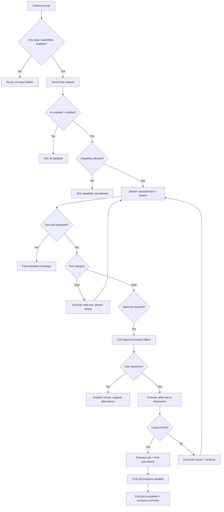
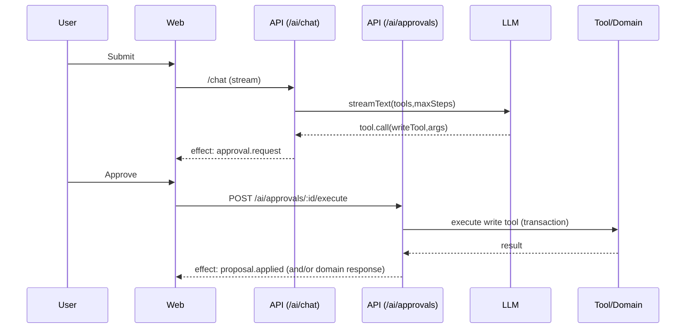

# AI Flow (Launch State)

This is the production behavior of AI in Accountable Books as shipped. It describes the runtime from:

1. user input in the command bar
2. streaming assistant response and tool execution
3. approvals and long-running jobs
4. final user-visible outcomes (messages, previews, UI effects, created/updated records)

It is intentionally written as an operational doc: if you follow it, you’ll understand the exact forks and decisions that occur during a request.

## Concepts

- **One assistant**: the user is always talking to the same assistant across the app.
- **Domain**: a product/system area (e.g. `journals`, `categorization`, `ledgers`). Domains are used for scoping, filtering, and capability registration.
- **Capability**: a named unit of behavior that can be invoked by the assistant. A capability owns:
  - its prompt/system instructions
  - its toolset
  - its safety and approval policy
  - its output shape (effects + proposals)
- **Tools**: server-owned functions the model can call. Tools are the only way to read/write company data.
- **Effects**: typed, structured artifacts returned to the UI (proposal previews, navigation intents, inline highlights, job progress, etc).

### Clarification: “One Assistant” vs “Many Modes”

The user experiences one assistant and one continuous conversation thread.

Internally, the backend can swap the **system prompt**, **toolset**, and **skepticism level** based on the selected capability (and later, via a manager/router).

Rule:

- One thread, many capability modes.
- Each assistant turn is attributed to the capability that produced it.

## Where Things Live

Frontend:

- UI + local chat state: `apps/web/src/components/ai/ai-command-bar.tsx`
- Runtime store: `apps/web/src/modules/ai/runtime/store.ts`
- Domain/capability registration: `apps/web/src/features/**/ai/registration.ts`
- Capability keys: `apps/web/src/modules/ai/keys.ts`

Backend:

- Transport + orchestration: `apps/api/src/domains/ai/*`
- Capability registry (authoritative): `apps/api/src/domains/ai/capabilities/*`
- Providers (model selection): `apps/api/src/domains/ai/providers/*`
- Tool implementations (read/write): `apps/api/src/domains/ai/tools/*` and domain services (`apps/api/src/domains/**`)

Contracts:

- Shared schemas: `packages/contracts/accountable_contracts/schema/source/ai/*`

## Architecture

```mermaid
flowchart LR
  U[User] -->|Cmd+K / Launcher| W[Web App<br/>AI Command Bar]
  W -->|POST /api/:companyId/ai/chat (stream)| API[API AI Orchestrator]
  API -->|streamText + tools|maxSteps| LLM[LLM Provider]
  API --> DOM[Domain Services]
  DOM --> DB[(Postgres)]
  API --> Q[(Worker/Queue)]:::optional
  API -->|stream events| W

classDef optional fill:#111827,stroke:#334155,color:#e2e8f0;
```

## Runtime: What Happens When A User Submits

### Step 0: Page-Level Capability Registration (Frontend)

When a page renders, it registers AI capabilities for that page:

- Domain is registered (for scope/filter UI).
- Capabilities are registered (for what the assistant is allowed to do on this page).

This keeps AI invisible on pages that have no capabilities.

### Step 1: User Enters Text And Submits (Frontend)

The command bar performs:

1. Optimistic append of the user message to the active thread.
2. Determines **effective capability scope** based on UI state:
   - If the user is scoped to a domain chip, only capabilities from that domain are eligible.
   - If the user is on “All”, all page-registered capabilities are eligible.
3. Selects a **candidate capability** using deterministic scoring:
   - `cap.match(input)` (0..1) if defined, else a safe default.
4. Sends the request to the backend `/chat` endpoint with:
   - `capabilityId` (candidate)
   - `messages` (bounded to the last N messages)
   - `domain` tag (optional)
   - `context` (current route/page metadata)

Important: the frontend selection is a UX hint. The backend is authoritative.

### Step 2: Request Admission (Backend)

Before any model call:

1. Auth + tenant scope validation (`userId`, `companyId`).
2. AI global enablement check (entitlements and server flags).
3. Capability admission:
   - verify `capabilityId` exists in the server registry
   - verify it is enabled for this company/user and allowed on this route/domain
4. Safety policy setup:
   - `maxSteps`
   - allowed tool list
   - approval rules
   - rate limits/cost guardrails

If admission fails, the API streams a terminal error event and a human-readable assistant message.

### Step 3: Streaming Orchestration (Backend)

The orchestrator starts an AI SDK streaming run:

- Constructs system prompt from capability definition + context.
- Passes the tool map defined by the capability.
- Sets `maxSteps` so the agent can do multi-step work.

While streaming:

- Assistant text deltas are streamed as they generate.
- Tool calls appear as structured events.
- Tool outputs are streamed back (typically collapsed in UI).

### Step 4: Tool Calling (Backend)

When the model requests a tool:

1. Tool name is validated against capability’s allowed toolset.
2. Tool args are validated with Zod (strict inputs).
3. Tool execution happens server-side:
   - **Read tools** execute immediately.
   - **Write tools** require approval (see next section).
4. Outputs are returned to the model as tool results and also streamed to the UI as tool events (sanitized).

### Circuit Breakers (Hard Stops)

To prevent tool loops and runaway cost, the orchestrator enforces:

- `maxSteps` (model-side limit)
- `maxToolCalls` per request (server-side)
- repeated tool-call detection (same `toolName + argsHash` seen too often)
- wall-clock timeout per request
- token/cost budget per request (when provider metadata is available)
- per-user/per-company rate limiting

### Step 5: Effects And Proposals (Backend → Frontend)

During and/or at the end of the run, the backend emits typed effects.

Effects are used to:

- show a draft form (e.g. draft journal entry)
- show a preview card (“here is what I will apply”)
- request approval
- start a background job and display progress
- propose UI navigation or highlighting

The UI only executes effects it supports and considers safe in the current surface.

### Step 6: Completion (Backend → Frontend)

When the model finishes:

- the final assistant message is streamed and appended to the thread
- any final effects (proposal summary, navigation suggestion) are delivered
- the stream closes cleanly

## Decision Tree (All Forks)



## Streaming Wire Format (What The UI Receives)

The `/chat` stream emits typed events. The UI renders them into:

- message bubbles
- collapsed tool call rows
- approval prompts
- proposal cards and previews
- progress indicators

### Event Types

| Event               | Meaning                    | UI behavior                      |
| ------------------- | -------------------------- | -------------------------------- |
| `assistant.delta`   | partial assistant text     | append text in-place             |
| `assistant.message` | final assistant message    | commit message                   |
| `tool.call`         | tool was requested         | show tool row (collapsed)        |
| `tool.result`       | tool finished successfully | show success (collapsed)         |
| `tool.error`        | tool failed                | show failure; assistant explains |
| `effect`            | typed artifact for UI      | render/execute if supported      |
| `error`             | terminal error             | show message + retry affordance  |

### Effect Types

Effects are structured and validated. Common effects:

| Effect             | Payload                                     | Example                    |
| ------------------ | ------------------------------------------- | -------------------------- |
| `ui.navigate`      | `{ to: string }`                            | `{ "to": "/journals" }`    |
| `ui.highlight`     | `{ selector: string, label?: string }`      | highlight a field          |
| `proposal.preview` | `{ proposalId, title, summary, risk }`      | preview card               |
| `proposal.form`    | `{ proposalId, formType, data }`            | render editable draft form |
| `approval.request` | `{ approvalId, proposalId, summary, risk }` | approve/reject UI          |
| `job.started`      | `{ jobId, label }`                          | show background progress   |
| `job.progress`     | `{ jobId, pct, message? }`                  | update progress            |
| `job.completed`    | `{ jobId, resultSummary }`                  | completion toast + message |

## Approvals (Human-in-the-Loop Writes)

Write tools never execute without user approval.

Approval flow:

1. Model proposes a write via a write tool call.
2. Backend persists an **approval resource** and returns an `approval.request` effect (with summary + risk + `approvalId`).
3. UI displays approve/reject.
4. UI sends the decision to deterministic endpoints (no LLM re-entry):
   - `POST /api/:companyId/ai/approvals/:approvalId/execute`
   - `POST /api/:companyId/ai/approvals/:approvalId/reject`
5. Backend executes the approved action transactionally (idempotent by `approvalId`), records audit, and returns results.



## Long-Running Requests (Background Jobs)

Some tool calls enqueue jobs instead of blocking:

- bulk categorization
- imports
- large report generation

Flow:

1. Tool enqueues a job and returns `{ jobId }`.
2. Backend emits `job.started`.
3. The UI treats `jobId` as the source of truth for progress:
   - Poll: `GET /api/:companyId/jobs/:jobId`
   - Optional SSE: `GET /api/:companyId/jobs/:jobId/stream`
4. If the chat stream is still connected, the backend may emit best-effort `job.progress` updates, but the system does not rely on the chat connection staying open.
5. Completion emits `job.completed` (via polling/SSE) and the assistant posts a summary message when the user next opens AI (or immediately if connected).

No websockets are required: streaming + polling is sufficient.

## Errors (Exactly What Happens)

Errors are surfaced as both:

- a typed `error` event (machine-readable code)
- an assistant message (human-readable remediation)

### Error Classes

| Class              | Example                                | Result                                              |
| ------------------ | -------------------------------------- | --------------------------------------------------- |
| Validation (400)   | invalid request body                   | assistant explains and asks to retry                |
| Not allowed (403)  | AI disabled or capability not entitled | assistant explains disabled state                   |
| Provider (429/5xx) | rate limit/outage                      | assistant suggests retry; safe auto-retry may occur |
| Tool failure       | DB constraint/missing data             | tool.error event + assistant remediation            |
| Disconnect         | client drops mid-stream                | UI resumes stream and continues                     |

## Backend: How Capabilities And Tools Are Registered

The backend capability registry is authoritative.

Each capability defines:

- stable `capabilityId`
- optional `domain`
- `prompt` builder
- `tools` map
- `policy` (`maxSteps`, approvals, limits)

### Conversation Context (Summaries + Working Memory)

The orchestrator does not rely on “last N messages” alone.

It maintains a conversation context bundle:

- recent raw messages (window)
- rolling summaries (token-saving)
- structured working memory (entities and references: transaction ids, vendor ids, accounts, dates)

When the thread grows:

- the backend periodically summarizes older segments into the summary + memory store
- the model sees the summary + the recent window, not an unbounded transcript

Tools are defined with:

- `inputSchema` (Zod)
- `execute(ctx, args)` (server-side)
- `read/write classification`
- `needsApproval` logic (write tools only)

## Persistence (What We Store)

We persist:

- conversations and messages (with domain and capability tags)
- tool calls and tool results (sanitized)
- approvals and decisions
- proposals and their statuses
- job metadata (for long-running tasks)

Retention is configurable (default: rolling window; older records are pruned per policy).

## Ops Checklist (Launch Behavior)

- AI can be disabled globally or scoped by domain/capability.
- Every write is approval-gated and audited.
- All tool inputs/outputs are schema-validated.
- Streaming is resilient to brief disconnects (resume supported).
- Provider fallbacks and retries are enabled for safe operations.
