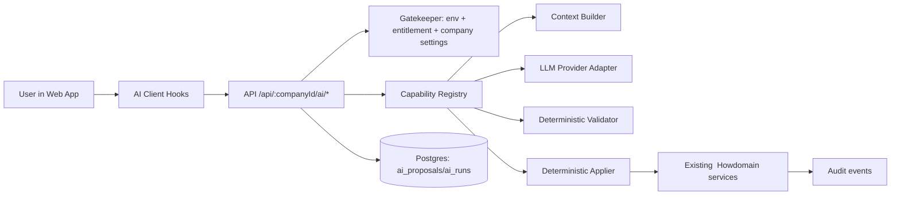
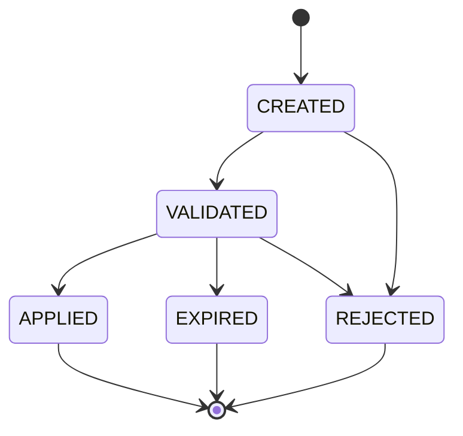
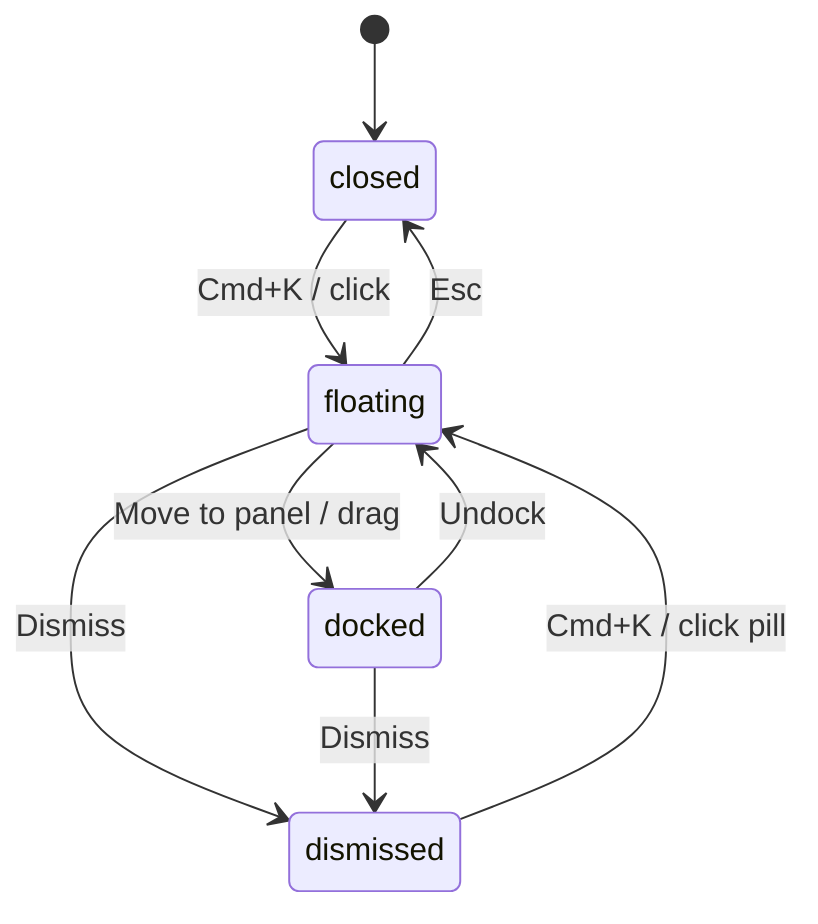

# AI Platform Plan v2 (Implementable)

Status: ready to execute  
Owner: Platform + Accounting Domains  
Date: 2026-02-14
Canonical: this file supersedes `my-notes/ai-platform-v2-journals-first.md`.

This version converts the AI direction into a build plan aligned with current architecture:

- multi-tenant API under `/api/:companyId/*`
- deterministic accounting constraints
- intent-based mutations
- queue/worker patterns
- existing audit primitives

---

## 1) Scope and Non-Goals

### In scope (v1-v2 rollout)

- In-app AI proposals for accounting workflows.
- Deterministic validation and controlled apply.
- Full proposal/apply audit trail.
- Feature gating (ops, entitlement, per-company settings).
- First milestone: **app-level AI runtime + UI** (toggleable command bar) + **per-domain capability registration** + state management.

### Out of scope (later)

- External channels (WhatsApp/Slack/email wrappers).
- Autonomous posting without explicit company-level auto-apply policy.
- Unscoped “chat about anything” that bypasses the capability registry and deterministic apply paths.

---

## 2) Core Principles

1. AI never writes directly to domain tables.
2. Every proposal has explicit lifecycle state.
3. Every apply path maps to a deterministic domain service.
4. All endpoints are tenant-scoped: `/api/:companyId/ai/*`.
5. Server-side gating decides access and spend.
6. Capability contracts are typed and shared (web/api/ML) via `@accountable-books/contracts`.
7. Frontend registration controls UX only; backend registration controls authority.

---

## 2.1) Tightened Boundaries (Non-Negotiable)

AI here is not “a layer”; it is a product subsystem. To keep it maintainable, we keep boundaries hard:

- **apps/api**: authoritative execution, gating, persistence, audit writing, provider calls.
- **packages/contracts**: canonical schemas + IDs (no runtime provider code).
- **apps/web**: capability discovery/UX registration + reusable kit; never authoritative gating.

Apps stay thin, shared/central logic stays centralized with explicit contracts.

Defaults (so this stays implementable):

- First ship is the **AI runtime + command bar shell + registration** (no irreversible mutations required to demonstrate value).
- First “real” domain integration can be journals draft creation (no posting, no auto-apply).
- Capability output uses existing schemas where they already exist (e.g. `journalBatchInput`) once we implement a real capability.
- Capability “authority” is server-side only; frontend capability registration is UX-only.

---

## 3) Target Architecture



---

## 3.1) Code Organization (Maintainable)

Backend:

- `apps/api/src/domains/ai/` (platform/orchestrator)
- `apps/api/src/domains/ai/capabilities/` (registry + shared types)
- `apps/api/src/domains/ai/providers/` (provider implementations; swappable)
- `apps/api/src/domains/journals/ai/` (journals capability definitions only)
- `apps/api/src/domains/categorization/ai/` (later: categorization capability definitions)

Frontend:

- `apps/web/src/modules/ai/` (runtime, store, registration, API client, gating UX)
- `apps/web/src/components/ai/` (reusable UI kit: command bar, chips, indicators, preview)
- Domain registration files live with the domain feature:
  - `apps/web/src/features/manage-journals/ai/*`
  - `apps/web/src/features/cat-engine/ai/*`

---

## 4) Capability Lifecycle

Proposal state machine:



Rules:

- `CREATED`: LLM output parsed and stored.
- `VALIDATED`: deterministic checks passed.
- `APPLIED`: applier executed successfully.
- `REJECTED`: failed validation or user reject.
- `EXPIRED`: TTL reached (default 24h).

---

## 5) Data Model (must-have, not optional)

## 5.1 `ai_proposals`

```sql
CREATE TABLE ai_proposals (
  id UUID PRIMARY KEY DEFAULT uuid_generate_v7(),
  company_id UUID NOT NULL REFERENCES companies(id) ON DELETE CASCADE,
  user_id UUID NOT NULL REFERENCES users(id) ON DELETE RESTRICT,
  capability_id TEXT NOT NULL,
  entity_type TEXT NULL,          -- e.g. bank_transaction, journal
  entity_id UUID NULL,
  input_payload JSONB NOT NULL,
  context_snapshot JSONB NOT NULL,
  proposal_payload JSONB NOT NULL,
  preview_payload JSONB NULL,
  explanation TEXT NULL,
  state TEXT NOT NULL CHECK (state IN ('CREATED','VALIDATED','APPLIED','REJECTED','EXPIRED')),
  validation_errors JSONB NULL,
  applied_result JSONB NULL,
  idempotency_key TEXT NULL,
  expires_at TIMESTAMPTZ NOT NULL,
  created_at TIMESTAMPTZ NOT NULL DEFAULT now(),
  updated_at TIMESTAMPTZ NOT NULL DEFAULT now(),
  UNIQUE (company_id, idempotency_key)
);
CREATE INDEX idx_ai_proposals_company_created ON ai_proposals(company_id, created_at DESC);
CREATE INDEX idx_ai_proposals_entity ON ai_proposals(company_id, entity_type, entity_id, created_at DESC);
```

## 5.2 `ai_runs`

```sql
CREATE TABLE ai_runs (
  id UUID PRIMARY KEY DEFAULT uuid_generate_v7(),
  proposal_id UUID NOT NULL REFERENCES ai_proposals(id) ON DELETE CASCADE,
  company_id UUID NOT NULL REFERENCES companies(id) ON DELETE CASCADE,
  capability_id TEXT NOT NULL,
  provider TEXT NOT NULL,
  model TEXT NOT NULL,
  prompt_version TEXT NOT NULL,
  prompt_hash TEXT NOT NULL,
  request_tokens INT NULL,
  response_tokens INT NULL,
  latency_ms INT NOT NULL,
  status TEXT NOT NULL CHECK (status IN ('SUCCESS','FAIL')),
  error_message TEXT NULL,
  trace JSONB NULL,
  created_at TIMESTAMPTZ NOT NULL DEFAULT now()
);
CREATE INDEX idx_ai_runs_proposal ON ai_runs(proposal_id, created_at DESC);
```

Retention:

- Keep `ai_proposals`: 180 days (or product policy).
- Keep `ai_runs`: 30-90 days (cost/debug policy).

---

## 6) API Contracts

All routes below are mounted under `apps/api/src/domains/ai/ai.routes.ts`.

## 6.1 POST `/api/:companyId/ai/proposals`

Request:

```json
{
  "capabilityId": "journals.from_text.v1",
  "payload": {
    "text": "Paid office rent 5,000 from cash on Jan 15"
  },
  "entity": { "type": "journal", "id": "optional-draft-id" },
  "idempotencyKey": "optional-client-key"
}
```

Response:

```json
{
  "success": true,
  "data": {
    "proposalId": "uuid",
    "state": "VALIDATED",
    "proposal": {},
    "preview": {},
    "explanation": "..."
  }
}
```

## 6.2 POST `/api/:companyId/ai/proposals/:proposalId/apply`

Request:

```json
{ "confirm": true }
```

Response:

```json
{
  "success": true,
  "data": {
    "proposalId": "uuid",
    "state": "APPLIED",
    "result": {}
  }
}
```

## 6.3 POST `/api/:companyId/ai/proposals/:proposalId/reject`

Request:

```json
{ "reason": "optional" }
```

## 6.4 GET `/api/:companyId/ai/history`

Query:

- `entityType`
- `entityId`
- `capabilityId`
- `limit`
- `cursor`

---

## 7) Gating and Policy

Request must pass all checks:

1. Ops switch:

- `AI_ENABLED=true` required.

2. Entitlement:

- New service: `features/entitlement/ai-entitlement.service.ts`
- Enforced in API middleware, never only frontend.

3. Company settings:

- Add keys in `settings.registry.ts`:
  - `ai_assist_enabled` (boolean, default false)
  - `ai_capabilities` (json map)
  - `ai_auto_apply_enabled` (boolean, default false)
  - `ai_daily_token_budget` (number)

Policy:

- If any check fails, return `403 AI_NOT_ENABLED`.

Precedence (tightened):

1. `AI_ENABLED` off => everything off (all capabilities, all routes).
2. Entitlement off => everything off (hard deny; no provider calls).
3. `ai_assist_enabled=false` => everything off (soft global deny).
4. `ai_capabilities[capabilityId] === false` => capability off.
5. Scope override off (page/domain) => capability off for that surface.

Implementation rule:

- **Never call providers until after all gating + budget checks pass.**

---

## 8) Capability Registry (Typed)

File: `apps/api/src/domains/ai/capabilities/types.ts`

```ts
export type AiCapability<I, O, P = unknown, R = unknown> = {
  id: string;
  inputSchema: z.ZodType<I>;
  outputSchema: z.ZodType<O>;
  previewSchema?: z.ZodType<P>;
  buildContext: (
    ctx: AiExecutionContext,
    input: I,
  ) => Promise<Record<string, unknown>>;
  invoke: (
    ctx: AiExecutionContext,
    args: { input: I; context: Record<string, unknown> },
  ) => Promise<O>;
  validate: (
    ctx: AiExecutionContext,
    output: O,
  ) => Promise<{ ok: true } | { ok: false; errors: unknown }>;
  preview?: (ctx: AiExecutionContext, output: O) => Promise<P>;
  apply: (ctx: AiExecutionContext, output: O) => Promise<R>;
};
```

Rules:

- `invoke` may call provider.
- `validate/preview/apply` must be deterministic.
- `apply` uses existing domain services only.

---

## 9) First Capability (Implement now - Journals)

Capability ID: `journals.from_text.v1`

Goal:

- Convert natural language accounting instructions into a draft journal proposal.

Input:

- `text`

Output:

- Reuse existing contracts where possible:
  - `@accountable-books/contracts` `journalBatchInput` shape, with enforced policy:
    - `status` forced to `draft` (proposal cannot post by default)
    - `entries` must be balanced and >= 2 (already enforced by schema + constraints)
  - plus a small AI-only envelope:
    - `assumptions: string[]` (what the model inferred)
    - `warnings: string[]` (needs user review)

Apply:

- Call existing journals/ledger deterministic services (no direct table writes).
- Concrete mapping:
  - `apply` calls `postJournalRecord({ data, companyId, userId })` with `status: 'draft'`.
  - Optionally allow user-driven “create + post” only via explicit UX flow and explicit server policy.

Validation:

- Ensure journal context belongs to tenant/company.
- Ensure COA/contact/project refs exist.
- Ensure constraints satisfied before apply.

Preview:

- Summarize journal fields and line-level debit/credit impact.

---

## 10) Frontend Delivery Plan

## 10.1 Minimal components

- `AiActionButton`
- `AiProposalPreview`
- `AiDiffDialog`
- `AiHistoryPopover`
- `AiCommandBar`
- `AiSuggestionChip`
- `AiInlineIndicator`

Paths:

- `apps/web/src/components/ai/*`
- `apps/web/src/modules/ai/*`

## 10.2 Initial UX

- Add a toggleable global command bar shell (collapsed by default).
- Let each domain register capabilities with app-level AI runtime.
- Do not require journals (or any domain) to be complete before the shell ships.
- Flow:
  1. user types command
  2. call propose endpoint
  3. show diff/preview dialog
  4. apply explicitly

No persistent side panel in v1.

Domain registration model (frontend, UX only):

```mermaid
flowchart LR
  PAGE[Domain Page] --> REG[registerDomain()]
  REG --> RUNTIME[AI Runtime Store]
  RUNTIME --> BAR[AiCommandBar]
  BAR --> API[POST /api/:companyId/ai/proposals]
  API --> BAR
  BAR --> APPLY[Apply Confirm]
  APPLY --> API2[POST /api/:companyId/ai/proposals/:id/apply]
```

---

## 10.3) AI Runtime State (Web) (Missing Piece - Add This First)

`aij-latest` works because it centralizes state (`activeDomain`, `registrations`, `inlineNotifications`, `insights`) and mounts a toggleable surface globally (Cmd+K). We should do the same, but:

- Keep “capability execution” authoritative on the backend.
- Keep the web runtime focused on: registration, state, UX orchestration, and calling propose/apply endpoints.

Recommended store (Zustand) shape:

```ts
export type AiDomainKey = string;
export type AiCapabilityId = string;

export type AiSurfaceMode = 'closed' | 'floating' | 'docked' | 'dismissed';
export type AiDockSide = 'right' | 'left';

export type AiCapabilityUI = {
  capabilityId: AiCapabilityId; // backend capability ID
  label: string;
  description: string;
  shortcutHint?: string; // e.g. "J"
  domain: AiDomainKey;
  // Optional: help the command bar suggest likely actions (do NOT auto-apply).
  match?: (input: string) => number; // 0..1
  // Optional: domain-specific result renderer hook.
  renderResult?: (proposal: unknown) => React.ReactNode;
};

export type DomainAIRegistration = {
  domain: AiDomainKey;
  domainLabel: string;
  capabilities: AiCapabilityUI[];
};

export type AiMessage = {
  id: string;
  role: 'user' | 'assistant';
  text: string;
  timestamp: number;
  meta?: { capabilityId?: AiCapabilityId; proposalId?: string };
};

export type AiRuntimeState = {
  // Global surface state (aij-latest/Colab pattern)
  surfaceMode: AiSurfaceMode;
  dockSide: AiDockSide;
  dockWidthPx: number; // persisted per user
  floatingX?: number; // optional: last floating position
  floatingY?: number;
  input: string;
  isLoading: boolean;

  // Registry + scope
  registrations: Map<AiDomainKey, DomainAIRegistration>;
  activeDomain: AiDomainKey | null;

  // UX state (thread is useful even when capability-driven)
  activeThreadId: string;
  threads: Record<
    string,
    { id: string; title?: string; messages: AiMessage[]; updatedAt: number }
  >;
  inlineNotifications: Array<{ id: string; text: string; ts: number }>;
  insights: Array<{
    id: string;
    domain: AiDomainKey;
    text: string;
    ts: number;
  }>;

  // Actions
  openFloating: () => void; // Cmd+K
  dock: (side: AiDockSide) => void; // “Move to panel”
  undock: () => void;
  close: () => void; // Esc
  dismiss: () => void; // collapse to pill
  setInput: (v: string) => void;
  setActiveDomain: (domain: AiDomainKey | null) => void;
  registerDomain: (reg: DomainAIRegistration) => void;
  unregisterDomain: (domain: AiDomainKey) => void;

  // Thread lifecycle safeguards (Colab/Gemini note)
  newThread: (opts?: { confirm?: boolean }) => void;
  confirmNewThreadRequired: () => boolean;

  // Orchestration calls (call backend propose/apply)
  propose: (args: {
    capabilityId: AiCapabilityId;
    payload: unknown;
    entity?: { type: string; id?: string };
  }) => Promise<{
    proposalId: string;
    preview?: unknown;
    explanation?: string;
  }>;
  apply: (proposalId: string) => Promise<unknown>;
};
```

Mounting (fits your app):

- Add an `AiRuntimeProvider` mounted once inside `apps/web/src/layouts/AppLayout.tsx` (so it has `companyId` and can react to page changes).
- Render `AiCommandBar` overlay from the provider so every page can toggle it with `Cmd+K` (same affordance as `aij-latest`).

Command bar surface state machine (web):



This section is intentionally “first”: without a crisp runtime/store, every domain will re-invent state and the app will get hard to maintain.

---

## 10.4) Docking, Drag-To-Dock, and “New Chat” Safeguards (Recommended)

The Google/Colab note is directionally correct for _dense workflows_: keep AI available without stealing layout by default, but allow persistence when users want it.

Adopt as follows:

- **Default**: floating command bar (bottom center) toggled via `Cmd+K`.
- **Move to panel**: explicit action that docks the surface as a right-side panel (resizable).
- **Drag-to-dock affordance** (optional but good):
  - when user drags the floating surface toward the edge, show a blurred “drop target” region
  - dropping docks the panel
- **New chat warning**:
  - if the current thread has messages, “New chat” should confirm before clearing context
  - this protects user workflow even in a capability-driven system because users build context iteratively

Important: “chat thread” here is a UX container for capability invocations, previews, and explanations. It must not become a bypass around the capability registry or deterministic apply.

Persistence policy (safe default):

- Persist surface state (mode, width, dock side) in local storage.
- Persist active thread messages in local storage keyed by `(userId, companyId)` for continuity.
- Do not persist raw prompts/server context snapshots by default on the server beyond `ai_proposals/ai_runs` and audit payloads.

---

## 11) LLM Integration Design

Path: `apps/api/src/integrations/llm/*`

Provider interface:

- `createStructuredOutput<T>(opts): Promise<T>`

Required controls:

- per-request timeout (e.g. 8s)
- max token guards
- strict JSON schema parsing
- fallback model policy
- prompt template versioning
- no raw prompt/body persistence by default

Provider implementation policy (tightened):

- Prompts are versioned and stored as `prompt_version` + `prompt_hash` only.
- Any stored `context_snapshot` must be **redacted** (no secrets, no full narratives unless explicitly approved).
- Treat “streaming” as an optimization, not a requirement for correctness.

AI SDK usage (optional, not required):

- You can implement `createStructuredOutput` using the AI SDK (`ai` / `@ai-sdk/*`) if you want its provider ecosystem and structured output helpers.
- Keep the AI SDK behind `apps/api/src/integrations/llm/*` so capabilities, gating, persistence, and audit are not coupled to it.
- Adopt it only after gating + budgets + deterministic apply are working (so it stays an implementation detail, not the architecture).

---

## 12) Observability and Audit

Audit actions (extend existing audit service):

- `ai.proposal_created`
- `ai.proposal_validated`
- `ai.proposal_applied`
- `ai.proposal_rejected`
- `ai.proposal_expired`

Implementation note (fits current code):

- `apps/api/src/domains/audit/audit.types.ts` currently scopes `entity_type` to `bank_transaction | journal`.
- For v1, write AI audit events against the _real entity_ (`journal` for `journals.from_text.v1`), and include `proposalId`, `capabilityId`, and `state` in the audit payload.
- Keep `ai_proposals` / `ai_runs` as the authoritative AI trace store; audit events remain the human/compliance timeline.

Metrics:

- proposal success rate
- validation pass rate
- apply rate
- rollback/edit-after-apply rate
- P50/P95 latency
- token/cost by company and capability

---

## 13) Security and Privacy Controls

- Never include secrets in prompts.
- Redact high-risk fields before model call.
- Store prompt hash, not full prompt by default.
- Add company/user rate limits for AI routes.
- Add budget enforcement before provider call.

---

## 14) Testing Strategy

## 14.1 Unit

- capability input/output parsing
- validator behavior
- policy/gating middleware

## 14.2 Integration (API)

- propose/apply lifecycle transitions
- tenant isolation on `/api/:companyId/ai/*`
- entitlement denied flow
- idempotency key behavior

## 14.3 Contract

- proposal schemas in `packages/contracts` for web+api typing

## 14.4 Replay tests

- deterministic re-validation of stored proposals after code changes

---

## 15) Rollout Phases

## Phase 0 (App-level AI runtime + UI shell)

- Implement `apps/web/src/modules/ai/*` runtime/store + `apps/web/src/components/ai/*` command bar UI.
- Implement domain registration API and mount the command bar globally (Cmd+K).
- Ship with “no registered capabilities” empty state copy (like `aij-latest`).

Exit:

- Command bar works across the app and domains can register/unregister capabilities without coupling.

## Phase 1 (Backend AI scaffold usable)

- Create `apps/api/src/domains/ai` endpoints + gating (even if provider is stubbed).
- Add proposal/run persistence tables and audit hooks.
- Wire web runtime `propose/apply` to these endpoints.

Exit:

- End-to-end propose/apply lifecycle works (even with stubbed capability output).

## Phase 2 (First real domain capability)

- Implement `journals.from_text.v1` (or another low-risk capability) behind the shell.
- Add domain-specific result renderers and previews where needed.

Exit:

- Users can do real work with AI proposals and explicit apply in at least one domain.

## Phase 3 (Hardening)

- Harden validation + failure UX.
- Add budget/rate limiting.
- Add dashboards/alerts.

Exit:

- Safe controlled beta for selected tenants.

## Phase 4 (Second domain)

- Add second capability: `transaction.clean_description.v1`.
- Add third capability: `categorization.interpret_command.v1`.
- Add AI history surfaces in transaction and journal details.
- Production rollout with entitlement plans.

Exit:

- Paid, auditable AI assist live for selected domains.

---

## 16) Immediate Build Tasks (start now)

1. Add migration files for `ai_proposals` and `ai_runs`.
2. Create `apps/api/src/domains/ai/`:

- `ai.routes.ts`
- `ai.controller.ts`
- `ai.service.ts`
- `ai.types.ts`
- `capabilities/registry.ts`

3. Add AI settings keys in `settings.registry.ts`.
4. Add entitlement middleware + route guard.
5. Implement stub LLM adapter in `integrations/llm`.
6. Implement first capability `journals.from_text.v1`.
7. Add Journals command input + preview/apply dialog in web.
8. Add vitest integration tests for proposal/apply lifecycle.

---

## 17) Release Gates (must pass)

- 0 cross-tenant data access findings in AI routes.
- 100% of applies produce audit event.
- P95 propose latency <= 4s (excluding provider incidents).
- Validation failure explains why and never mutates data.
- Kill switch disables all AI mutations and UI affordances immediately.

---

## 18) Execution Checklist (Do This In Order)

Use this as the live implementation tracker.

### Step 1: Web AI runtime + app-level UI + registration

- [ ] Create `apps/web/src/modules/ai/*` runtime/store with the state model in `10.3`.
- [ ] Create `apps/web/src/components/ai/*` command bar UI (toggleable; Cmd+K; dismissed pill).
- [ ] Add domain registration API and mount provider once inside `apps/web/src/layouts/AppLayout.tsx`.
- [ ] Provide empty-state UX (“No capabilities on this page”) and capability chips when registered.

Definition of done:

- [ ] Command bar toggles on every page, keeps state stable, and never breaks core flows when disabled.
- [ ] Domains can register capabilities without importing each other.

### Step 2: Backend AI scaffold (authoritative propose/apply)

- [ ] Add settings keys in `apps/api/src/domains/settings/settings.types.ts` and `apps/api/src/domains/settings/settings.registry.ts`:
  - `ai_assist_enabled`
  - `ai_capabilities`
  - `ai_scope_overrides`
- [ ] Add AI route mount in `apps/api/src/app.ts`.
- [ ] Create `apps/api/src/domains/ai/` skeleton (`routes`, `controller`, `service`, `registry`, `gating`).
- [ ] Add migrations for `ai_proposals` and `ai_runs`.
- [ ] Add provider adapter interface in `apps/api/src/integrations/llm/*`.
- [ ] Add initial audit actions (`ai.proposal_created`, `ai.proposal_applied`, `ai.proposal_rejected`).

Definition of done:

- [ ] `POST /api/:companyId/ai/proposals` works with stub provider.
- [ ] Disabled gating returns `403 AI_NOT_ENABLED`.

### Step 3: Contracts + first real capability (choose domain later)

- [ ] Add capability contracts in `packages/contracts/accountable_contracts/schema/source/ai/*`.
- [ ] Build/export contracts package.
- [ ] Implement the first real capability in API (journals is recommended, but not required for the shell).
- [ ] Implement deterministic validate + preview + apply mapping to existing domain services.
- [ ] Add API integration tests for proposal lifecycle.

Definition of done:

- [ ] From plain text input, API returns validated journal proposal and preview.
- [ ] Apply path creates expected draft/post result through existing services only.

### Step 4: Hardening and operations

- [ ] Add per-company rate limit + budget enforcement.
- [ ] Add metrics for latency, proposal success, validation failure, apply rate.
- [ ] Add runbook for kill switch and provider outage behavior.

Definition of done:

- [ ] P95 propose latency and failure alerts visible on dashboard.
- [ ] Kill switch verified in staging.

---

## 19) Remaining Choices (With Safe Defaults)

These are not blockers for starting, but they must be made explicit to avoid “AI sprawl”.

- `journals.from_text.v1` apply behavior:
  - Default: create draft journal only.
  - Later: allow “create + post” only when user explicitly chooses “Post now” and server policy allows it.
- Existing draft editing:
  - Default: v1 creates new drafts only.
  - Later: add `journals.modify_draft.v1` as a separate capability to avoid silent destructive edits.
- Global command bar scope:
  - Default: available everywhere, but shows “no capabilities on this page” if none registered (mirrors `aij-latest`).
  - Later: restrict to accounting workspace if noise becomes an issue.
- Entitlement implementation:
  - Default: stub service that returns “not entitled” unless explicitly enabled for internal tenants via settings.
  - Later: plug Stripe/plan enforcement behind the same interface (no refactor).
